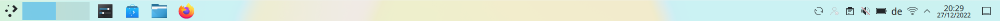
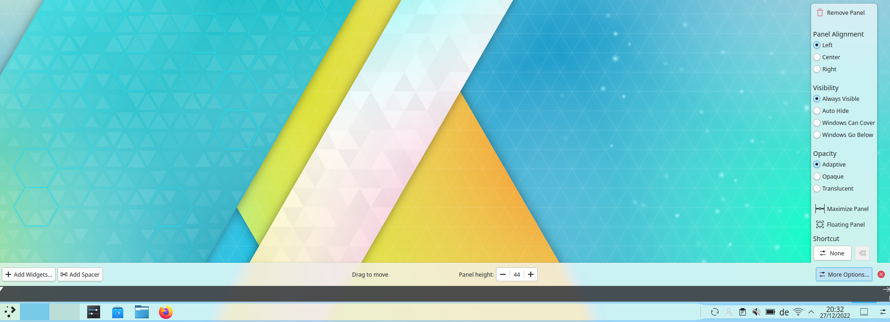
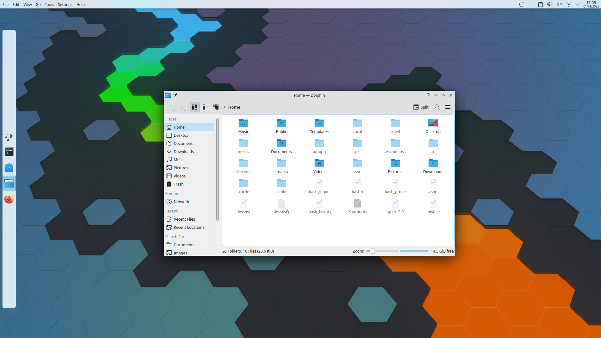

# Panels

A panel is a widget container that can sit on any side of the screen. There can be several panels on the screen, or even on the same side. The default layout, from the **Silver Light - Bottom Panel** [global theme](../settings/global-theme.md), is one panel across the bottom of the desktop with these widgets: the [Application Launcher](kickoff.md), the [pager](pager.md), the [Task Manager](tasks.md) with your file manager and your web browser pinned to it, the [system tray](system-tray.md) (including things like power management if you're on a laptop), the [digital clock](clocks.md) and [Peek at Desktop](desktop-buttons.md). If your system language usually needs an input method, such as Chinese, Japanese, Korean or Hindi, the panel also gets the [Input Method Panel](input-method-panel.md) widget.

## Configuration

To configure a panel, right-click it and choose **Enter Edit Mode**, then click the panel to open **Panel Settings**, or right-click it and choose **Show Panel Configuration**.

### Arranging widgets

In Edit Mode, widgets in the panel can be arranged by dragging them. Widgets align to the left of a horizontal panel and the top of a vertical one. You can center widgets by adding flexible spacers on both sides.

### Panel Settings

- **Position:** **Top**, **Right**, **Left** or **Bottom** of the screen. **Set Position…** chooses by dragging.
- **Alignment:** The side of the screen the panel sits against, if it doesn't fill it.
- **Width** or **Height:** **Fill width** or **Fill height**, **Fit content**, or **Custom**.
- **Visibility:**
  - **Always visible:** Keeps the panel visible at all times, even when windows are maximized.
  - **Auto hide:** Hides the panel off screen until the mouse is placed near the screen edge.
  - **Dodge windows:** Hides the panel only while a window would touch it.
  - **Windows go below:** Lets windows go below the panel, even when maximized.
- **Opacity:**
  - **Adaptive:** Makes the panel opaque when any windows are touching it, and translucent otherwise.
  - **Opaque:** Makes the panel always opaque.
  - **Translucent:** Makes the panel always translucent.

  If your desktop style doesn't support these choices, a help button next to **Opacity** says so.
- **Floating:**
  - **Disabled:** Neither the panel nor its widgets float.
  - **Applets only:** The panel stays against the screen edge, and the widgets on it are drawn as floating.
  - **Panel and applets:** The panel floats away from the screen edge with some margin around it.
- **Panel Height:** or **Panel Width:** The thickness of the panel. A vertical panel shows **Panel Width:**.
- **Focus shortcut:** Sets a keyboard shortcut for this panel. See [Using a panel with the keyboard](#using-a-panel-with-the-keyboard).

If the panel's settings are a combination that isn't supported, a warning appears with a **Fix it** button, which puts **Floating** and **Opacity** back to their defaults.

**Add New** adds **Widgets…**, which opens a sidebar from which you can drag widgets into the panel, a **Spacer** or a **Margins Separator**. A spacer normally uses as much space as possible. In Edit Mode, you can give it a fixed size instead.

At the bottom of Panel Settings:

- **Delete Panel** removes the panel. You can undo this.
- **Clone Panel** creates a new panel with the same settings and widgets. Arrows appear at the edges of each screen: click one to choose where the copy goes.
- **Exit Edit Mode** closes Panel Settings. If you started Edit Mode from the desktop, this button is called **Close**.

## Using a panel with the keyboard

The panel's **Focus shortcut** gives the keyboard to that panel. Press it again to give the keyboard back to the window you were using. Meta+Alt+P does the same for all your panels in turn: each press moves to the next panel, and after the last one the keyboard goes back to your window.

While a panel has the keyboard, the arrow keys move between its widgets, and Space or Return activates one.

- A panel that hides itself (**Auto hide** or **Dodge windows**) appears as soon as you press its shortcut, and stays until you press the shortcut again, press Escape or click somewhere else.
- While one of the panel's menus or dialogs is open, the panel keeps the keyboard, so the keys go to that menu or dialog.
- Escape goes first to the menu or widget that's using it. Only when nothing in the panel needs it does Escape close the panel and give the keyboard back.

## Adding panels

Having more than one panel on your desktop is useful if you want a more flexible layout:

To add a new panel, right-click the desktop and choose **Add Panel**, then pick the kind of panel:

- **Default Panel:** A panel with the standard widgets: the Application Launcher, the pager, the Icons-Only Task Manager, the system tray, the digital clock and Peek at Desktop.
- **Empty Panel:** A blank panel with no widgets in it.
- **Application Menu Bar:** A thin panel at the top of the screen holding the [Global Menu](global-menu.md), which shows the menu bar of the active application.
- **Silver Bottom Panel** and **Silver Left Panel:** The panels of the Silver look, at the bottom or the left of the screen, with the Application Launcher, the pager, a task manager with your file manager and web browser pinned, the system tray, the digital clock and Peek at Desktop. The bottom one has the Task Manager, which is what SonicDE starts with; the left one has the Icons-Only Task Manager.
- **Terminal Panel:** A panel at the top of the screen that hides itself and holds the [Terminal Panel](widgets.md#terminal-panel) widget, a full terminal that comes down when you need it.

## Under the hood

If anything untoward happens to your panel, have a look at `~/.config/sonic-org.sonicde.desktop-appletsrc`. The panel is classed as a *containment*, as is the desktop, which is home to all the widgets you put there.
