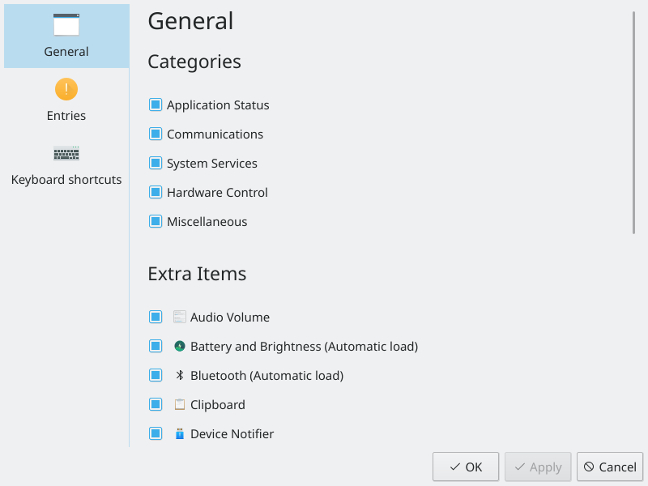
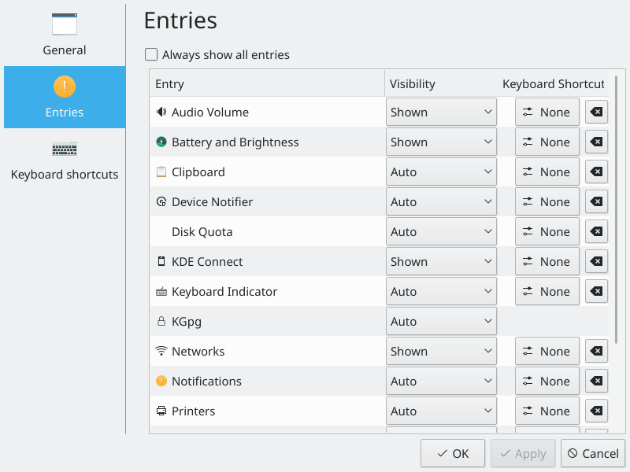

# System Tray

The System Tray widget displays system information, notifications and services.

## Features

- Displays system information
- Holds the [Disks & Devices](device-notifier.md) and Notifications widgets
- Lets you interact with applications that run in the background
- Lets you interact with devices connected to your computer
- Shows information about an application's status when you hover over its icon

## The System Tray widget

The System Tray is a widget normally found at the right of the standard panel. It typically holds the Notifications widget, [Disks & Devices](device-notifier.md), the [Clipboard](../applications/clipboard.md), Audio Volume, and external equipment such as [Bluetooth](../applications/bluetooth-overview.md) devices and printers. Other applications may also use it.

To interact with an application in the System Tray, left-click its icon. To open its settings, right-click it. Some icons may be hidden, either because the service isn't active or because it's been set to hide. You can always bring up a hidden icon by clicking the arrow in the tray.

## Settings

Since the System Tray is a widget, you can place it in another panel or on the desktop. To open its settings, right-click somewhere in the System Tray outside the service icons, for example on the arrow.

The settings list all the services that can show up in the System Tray, grouped into Application Status, Communications, System Services, Hardware Control and Miscellaneous. For each one, choose when it should appear:

- **Show when relevant:** You only see the icon when the service is active.
- **Always show:** The icon is shown even when the service isn't active.
- **Show only in popup:** The item only appears in the expanded popup.
- **Never show (disable):** The icon is always hidden.
