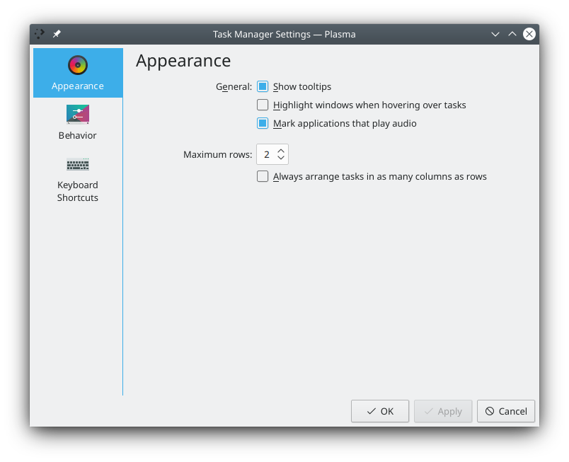
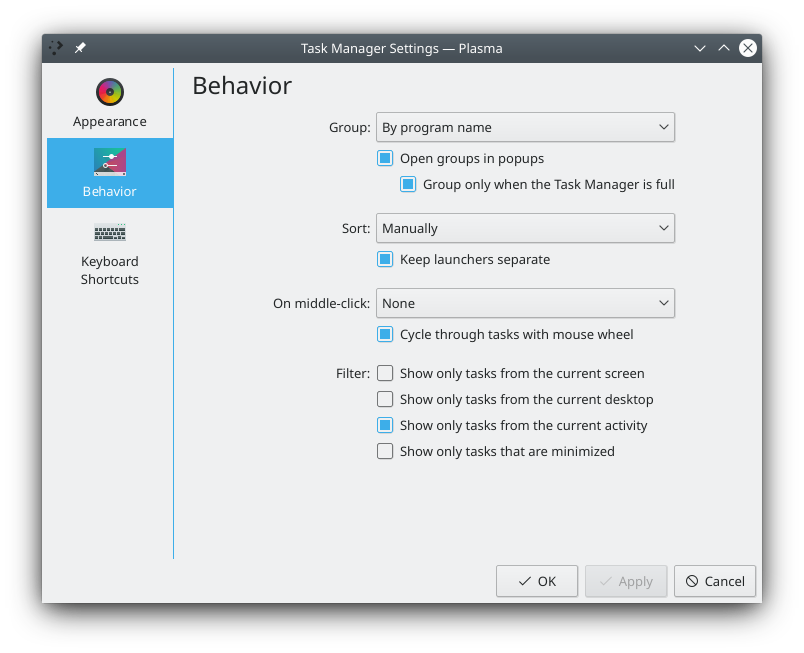
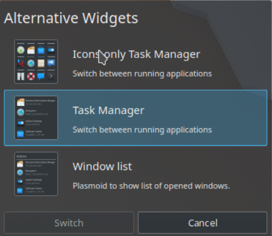
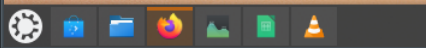
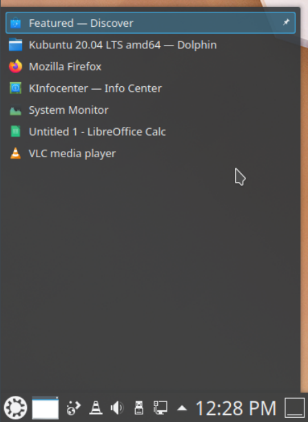

# Task Manager

The Task Manager gives you easy access to running applications. It sits in the middle section of the panel. If an application's window is behind other windows or minimized, click its entry in the Task Manager to bring it up, ready for input.

## The Task Manager widget

The Task Manager is a widget, so you can place it anywhere. For example, you could add a new panel at the top of the screen and put it there, or place it on the desktop. You can even have several copies in various places.

Whenever you start an application, a new entry appears in the Task Manager, showing the application's icon and the title of the window that opened.

If you click the entry for the active window, that window is minimized. If there are still windows that aren't minimized, the frontmost of them becomes active. If you click the entry for a minimized window, it appears in front of all other windows and becomes active. The same happens if you click the entry for a window behind other windows.

You can also right-click an entry to bring up the context menu, which has a number of options. For example, you can set which virtual desktops the window appears on, and close the window.

If you have many windows open, the entries may be grouped. Clicking a group shows its windows, which you can use just like ordinary Task Manager entries. Right-clicking a group lets you close all the windows in it.

You can also activate windows by holding Alt while pressing Tab one or more times. This goes through all windows, whether displayed or minimized.

> **Note:** Some applications don't open a window when started, so they don't show up in the Task Manager. Instead, they have an icon in the [System Tray](system-tray.md).

## Configuration

To open the Task Manager's settings, right-click it and choose **Configure Task Manager…**. If you have trouble clicking it rather than one of its tasks, enter Edit Mode first, so that clicking anywhere on the Task Manager works.

Some settings only appear in the standard Task Manager and not in the [Icons-Only Task Manager](#icons-only-task-manager), and the other way round. This is noted below.

### Appearance

**General:**

- **Show small window previews when hovering over tasks:** Hovering over a task shows a small preview of its window.
- **Hide other windows when hovering over previews:** While you hover over a preview, the other windows are hidden so you can see that window clearly. When previews are off, this setting is called **Hide other windows when hovering over tooltips**.
- **Show an indicator when a task is playing audio:** Marks applications that play audio with a small loudspeaker symbol, which makes it easier to tell where sound is coming from.
- **Mute task when clicking indicator:** Clicking the loudspeaker symbol mutes that application. This needs the audio indicator to be on.
- **Show media and volume controls in tooltip:** Adds playback and volume controls to the task's tooltip.
- **Fill free space on panel:** The Task Manager grows to use the free space in the panel.

The audio settings need the sound system support to be installed; otherwise they're greyed out.

- **Maximum task width:** (standard Task Manager on a horizontal panel only) How wide a task button may get: **Narrow**, **Medium** or **Wide**.
- **Use multi-row view:** (**Use multi-column view:** on a vertical panel) Puts tasks in more than one row or column: **Never**, **When panel is low on space and thick enough**, or **Always when panel is thick enough**.
- **Maximum rows:** (**Maximum columns:** on a vertical panel) The most rows or columns of tasks to use.
- **Spacing between icons:** (Icons-Only Task Manager only) **Small**, **Normal** or **Large**.

### Behavior

- **Group:** **Do not group** or **By program name**.
- **Clicking grouped task:** What happens when you click a group:
  - **Cycles through tasks:** Each click brings up the next window of the group.
  - **Shows small window previews:** Shows previews of the group's windows.
  - **Shows large window previews:** Shows the group's windows side by side. If the window manager can't do this, a message says so and a textual list is shown instead.
  - **Shows textual list:** Shows a list of the group's windows.
- **Combine into single button** and **Group only when the Task Manager is full:** (standard Task Manager only) How groups are shown.
- **Sort:** **Do not sort**, **Manually**, **Alphabetically**, **By desktop**, **By activity** or **By horizontal window position**.
- **Keep launchers separate:** (standard Task Manager only, with **Manually** sorting) Keeps pinned launchers apart from the running tasks.
- **Hide launchers after application startup:** (standard Task Manager only) A pinned launcher disappears while its application is running.
- **Clicking active task:** **Minimizes the task** when it's checked.
- **Middle-clicking any task:** **Does nothing**, **Closes window or group**, **Opens a new window**, **Minimizes/Restores window or group**, **Toggles grouping** or **Brings it to the current virtual desktop**.
- **Scrolling behavior:** What the mouse wheel does over the Task Manager: **Does nothing**, **Cycles through all tasks**, **Cycles through the hovered task’s windows** or **Adjusts the hovered task’s volume**. **Skip minimized tasks** leaves minimized windows out when cycling.
- **Show only tasks:** Limits the tasks shown to those **From the current desktop**, **From the current activity**, **From the current screen** or **That are minimized**.
- **When panel is hidden:** **Unhide when a window wants attention** shows a hidden panel when a window asks for your attention. If you turn this off, a message suggests first looking for a setting in the application that asks for attention too often.
- **New tasks appear:** Whether new tasks are added **To the right** or **To the left** of the existing ones (**On the bottom** or **On the top** on a vertical panel).

## Alternative task managers

You can swap the standard Task Manager for two other options. Right-click the Task Manager and choose **Show Alternatives…**. One option is the **Icons-Only Task Manager**, and the other is the **Window List**.

### Icons-Only Task Manager

The Icons-Only Task Manager shows tasks by their icon only, without the window title. This needs less space, so more tasks fit. It has by and large the same settings as the standard Task Manager.

### Window List

With the Window List, the task manager shrinks to a single button that shows the active application. Clicking the button opens a menu of your open windows; choose one to switch to it.

Its settings, on the **General** page:

- **For active application, show:** **Icon and name**, **Icon** or **Name**. On a vertical panel only the icon can be shown, and on the desktop this setting doesn't apply; a note says so.
- **Open on hover:** **Enabled, with delay:** opens the menu when the pointer rests on the button, after the number of milliseconds you set. The default is off, with a delay of 300 ms.
- **Show only windows:** **From the current desktop**, **From the current activity**, **From the current screen** or **That are minimized**. The first two are on by default.
- **Sort:** **By time opened**, **Alphabetically**, **Alphabetically, grouped by virtual desktop** (the default), **Alphabetically, grouped by activity**, **By last activated time** or **By horizontal window position**.
