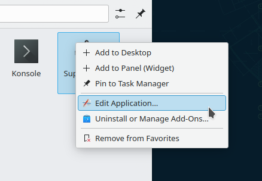
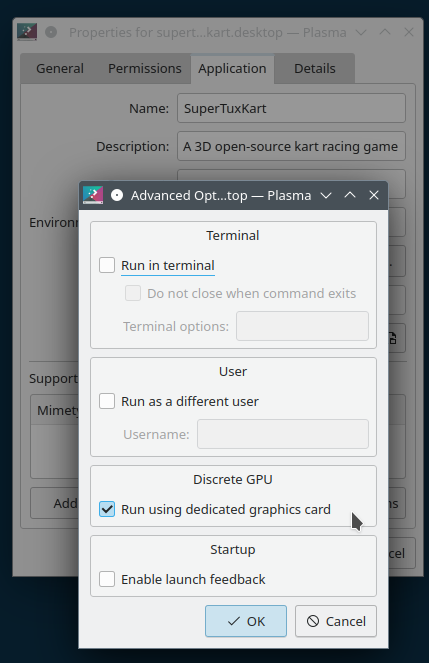

# Desktop tips

This page lists common tweaks you might make to set up a nice desktop.

## Starting up

### Don't restore the session on login

By default, applications that were open when you logged out can start again. To change this, open the [Session](../settings/session.md) module and choose **Start with an empty session**.

## Desktop

### Hide a System Tray icon

Right-click the arrow in the [System Tray](system-tray.md), and open its settings. For the item you want to hide, such as Networks, Clipboard or Battery, choose **Never show (disable)** or **Show only in popup**.

### A classic "Start" menu

Right-click the launcher and choose **Show Alternatives…**, then **Application Menu**.

### Don't sort windows in the Task Manager

Right-click an empty area of the [Task Manager](tasks.md) and open its settings. Set **Sort** to **Manually** and clear **Keep launchers separate**.

### Hide windows from other desktops in the Task Manager

In the Task Manager's settings, under **Show only tasks**, tick **From the current desktop**.

### Pin applications to the Task Manager

Start the application, right-click it in the Task Manager and choose **Pin to Task Manager**.

### Hide the audio indicator in the Task Manager

In the Task Manager's settings, clear **Show an indicator when a task is playing audio**.

### Turn off middle-click paste on the desktop

Right-click the desktop and choose **Desktop and Wallpaper**. On the **Mouse Actions** page, remove the Middle-Button action. See [Mouse actions](mouse-actions.md) for the other things that page can do.

### Turn off a screen corner

In the [Screen Edges](../settings/screen-edges.md) module, set the corner to **No Action**.

### Switch desktops with Ctrl+Alt+Left and Right

In the [Shortcuts](../settings/shortcuts.md) module, under SonicWin, set **Switch One Desktop to the Left** to Ctrl+Alt+Left and **Switch One Desktop to the Right** to Ctrl+Alt+Right.

### Don't switch desktops when scrolling over the wallpaper

SonicDE doesn't switch desktops when you scroll over the desktop, unless a mouse action for it has been added. To remove it, right-click the desktop and choose **Desktop and Wallpaper**. On the **Mouse Actions** page, remove the Vertical-Scroll line that uses **Switch Desktop**.

### Turn off the bouncing cursor when applications open

In the [Pointers](../settings/pointers.md) module, under **Launch feedback**, set **Pointer feedback** to **None**.

### Turn off focus stealing prevention

In the [Window Behavior](../settings/window-behavior.md) module, on the **Focus** tab, set **Focus stealing prevention** to **None**.

### Fix Alt+Click in games and other software

Holding a modifier key and dragging moves a window. If this conflicts with software designed for other systems, such as games, Inkscape or Blender, go to the [Window Behavior](../settings/window-behavior.md) module. On the **Window Actions** tab, under **Inner Window, Titlebar, Frame**, change **Modifier key**, or set the left button to do nothing to turn it off completely. The default is Meta.

### Show the Alt+Tab popup as fast as possible

Normally it waits 90 milliseconds before trying to show the popup, which makes quick switches faster since nothing has to be drawn. To remove the wait, set `DelayTime=0` under the group `[TabBox]` in `~/.config/kwinrc` and reload SonicWin. These commands do that for you:

```sh
kwriteconfig6 --file ~/.config/kwinrc --group TabBox --key DelayTime 0
qdbus6 org.kde.KWin /KWin reconfigure
```

You can also turn off the highlighting of the selected window, by clearing **Show selected window** in the [Task Switcher](../settings/task-switcher.md) module.

### Turn off the lock screen

In the [Screen Locking](../settings/screen-locking.md) module, turn off **Lock screen automatically** and **Lock after waking from sleep**.

### Turn off the logout and shutdown confirmation

In the [Session](../settings/session.md) module, turn off **Ask for confirmation**.

### Windows-style keys for moving windows

In the [Shortcuts](../settings/shortcuts.md) module, under SonicWin, set:

- **Peek at Desktop:** Meta+M
- **Maximize Window:** Meta+Up
- **Minimize Window:** Meta+Down
- **Quick Tile Window to the Left:** Meta+Left
- **Quick Tile Window to the Right:** Meta+Right

### Change the titlebar height

In the [Fonts](../settings/fonts.md) module, change the size of the **Window title** font.

### Hide titlebars when maximized

Set `BorderlessMaximizedWindows=true` under the group `[Windows]` in `~/.config/kwinrc` and reload SonicWin. These commands do that for you:

```sh
kwriteconfig6 --file ~/.config/kwinrc --group Windows --key BorderlessMaximizedWindows true
qdbus6 org.kde.KWin /KWin reconfigure
```

### Start an application on a discrete GPU

This is also known as using `prime-run` or the `DRI_PRIME=1` environment variable.

Open the application launcher and right-click the application.



In the [SonicDE Menu Editor](../applications/menu-editor.md), open the **Advanced** tab and tick **Run using dedicated graphics card**.



## Meta key

### Open the launcher with the Meta key

This is the default. If it isn't working, make sure your launcher widget has a global shortcut such as Alt+F1 set. Right-click the launcher, choose **Configure Application Launcher…**, and on the **Keyboard Shortcuts** page set the shortcut to Alt+F1.

### Don't open the launcher with the Meta key

In the [Shortcuts](../settings/shortcuts.md) module, under Sonic Shell, find **Activate Application Launcher** and turn off Meta.

## Lock screen

### Change the lock screen wallpaper

In the [Screen Locking](../settings/screen-locking.md) module, set the wallpaper on the appearance settings.

## Ecco

### Double-click to open files

This is the default. It's set by **Clicking files or folders** in the [General Behavior](../settings/general-behavior.md) module.

### Always show hidden files

Use **View > Adjust View Display Style…**, tick **Show hidden files**, apply it to all folders and make it the default. See [the View Display Style dialog](../applications/ecco.md#the-view-display-style-dialog).

### Browse archives with Ecco

In Ecco's settings, on the **Interface** page, tick **Browse compressed files as folders**.

### Clean up the context menu

In Ecco's settings, on the [Context Menu](../applications/ecco.md#context-menu) page, clear the entries you don't want.

### Show the Terminal panel

Use **View > Show Panels > Terminal**, or press F4.

### Paste into the Terminal panel

Use **Settings > Configure Keyboard Shortcuts…**. For **Paste**, set the alternative shortcut, Shift+Insert by default, to none.

### Turn off file indexing

You may want to do this if the `baloo_file` process slows your system down, or if `~/.local/share/baloo/index` uses too much space. Run `balooctl6 indexSize` to see how the database's space is used.

To turn it off, clear **Enable File Search** in the [File Search](../settings/file-search.md) module.

## Virtual machines

### Stop the Meta key opening the host's launcher

For VirtualBox, for example:

1. Run the virtual machine.
2. Press the host key, right Ctrl.
3. Press Alt+F3, then choose **More Actions > Configure Special Application Settings…**.
4. Under window matching, set **Window class** to **Exact Match** and `virtualbox machine`.
5. Add the **Ignore global shortcuts** property, and set it to **Force** and **Yes**.

This also stops Screenies' screenshot shortcuts from working while the virtual machine's window is focused.

## Firefox

### Use SonicDE's file dialog

1. Make sure you have the `xdg-desktop-portal` and `xdg-desktop-portal-sonicde` packages installed.
2. Go to `about:config` in a new Firefox tab.
3. Search for `xdg-desktop-portal`.
4. Set `widget.use-xdg-desktop-portal.file-picker` to 1.
5. Restart Firefox.
