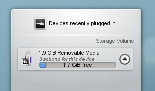
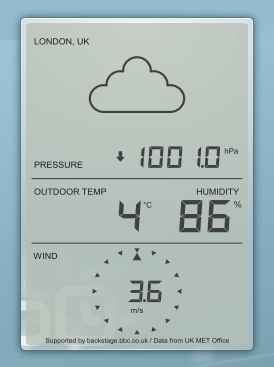
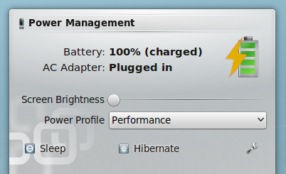
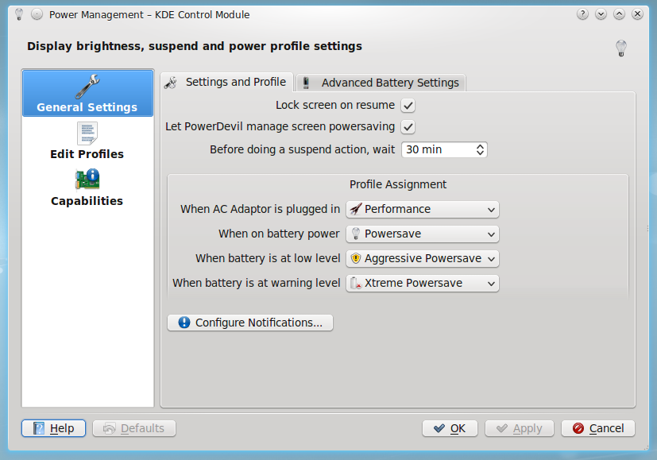
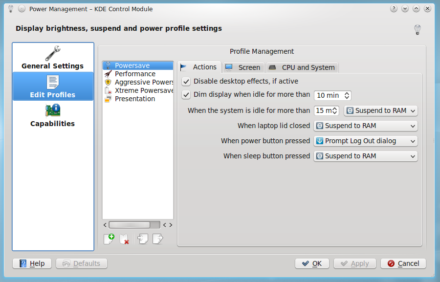
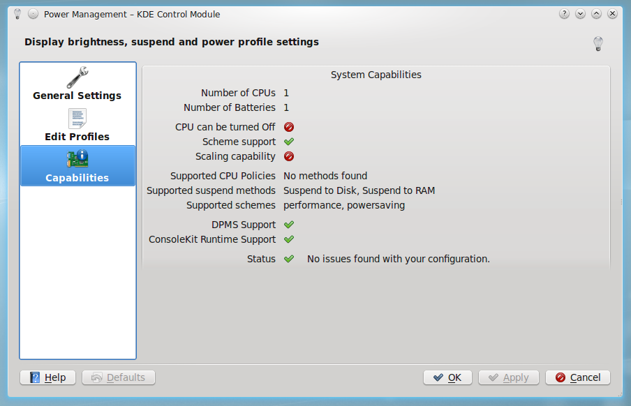

# Widgets

Here are some useful widgets. Others are available from a number of sources. If you need help installing them, see [Installing widgets](installing-widgets.md).

## System widgets

### Disks & Devices

The [Disks & Devices](device-notifier.md) widget handles pluggable devices such as USB sticks, digital cameras and external USB hard drives. It also comes into play when a medium such as a CD or DVD is loaded into an optical drive.

When you plug in an external device or load a medium, its window pops up. You can also open it by clicking its panel icon. It stays open while the pointer is over it, and otherwise hides itself after a few seconds.

The window lists all the devices it currently knows about, with the actions available for each. A mounted device has a small icon to the right of it. Clicking this unmounts the device or ejects the medium. Unmounting or ejecting can fail if the device still has files open, for example if a large copy hasn't finished. In most cases you can just wait a while and try again.

## The world outside

### Weather

Weather widgets are especially popular if you live in a country with very changeable weather.

The Weather widget gets its information from a choice of sources, such as BBC Weather from the UK Met Office, NOAA's National Weather Service, Environment Canada and Deutscher Wetterdienst. If it can locate a weather station near you, it gives you a range of details about the current weather.

It can also go in the panel, where it shows a small display with the current outside temperature.

## Power

### Battery

A battery icon sits in your panel. It shows the remaining charge, on the icon or when you hover over it. Click the battery to get the summary display. Its configure button takes you to the [Power Management](../settings/power-management.md) module.

These older screenshots show how it has looked:

