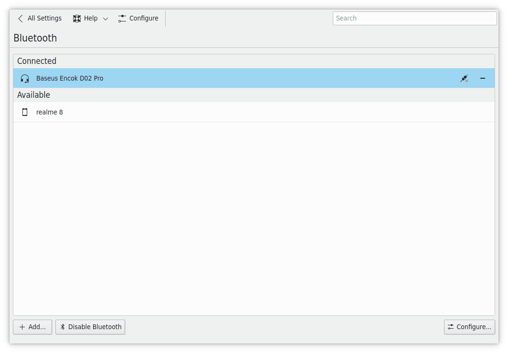
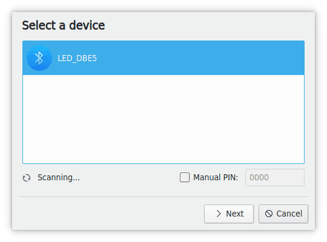
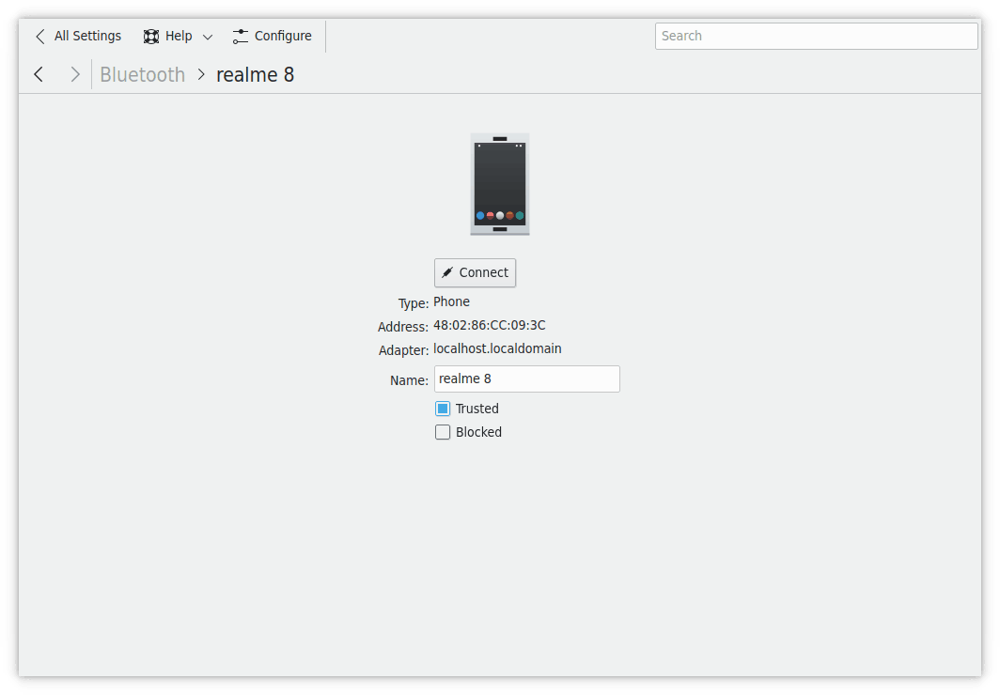
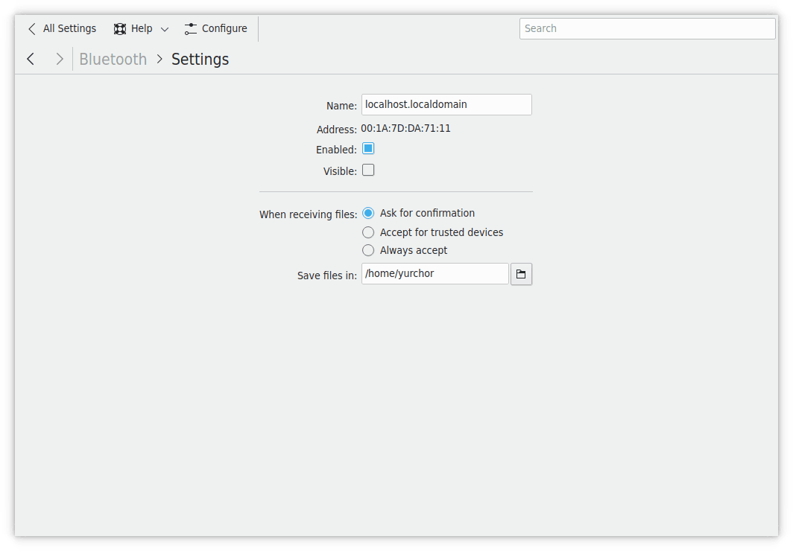
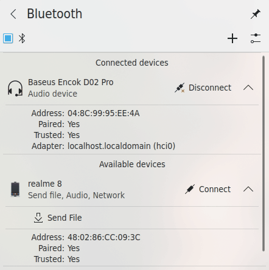

# Bluetooth

On this page you can configure your Bluetooth devices. The **Enabled** switch at the top turns Bluetooth on and off. If Bluetooth is off, you can also click **Enable** in the middle of the page. If no adapter is found, the page asks you to connect an external one.

## Pairing a device

**Pair Device…** opens the Add Bluetooth Device wizard, which scans your surroundings for devices. If the one you want isn't shown, see its manual for how to make it visible.

On the **Select a device** page:

- **Search…** filters the list of devices found.
- **Show unnamed devices** also lists devices that don't report a name.
- **Manual PIN:** Sets a PIN yourself, for devices that need a particular one.
- If Bluetooth is off, or your adapter doesn't accept new devices, a bar at the top says so, with **Enable** or **Make Pairable** to fix it.

Select the device and click **Next**. The rest depends on the device, so see its manual, but it's usually very straightforward:

- Some devices show a PIN. Check that it's the same as the one in the wizard, and click **Matches** or **Does not match**.
- A keyboard may ask you to type the PIN shown and press Enter.

When pairing works, a notification says the device has been set up. If it fails, **Restart the wizard** lets you try again.

## Managing devices

Click a device in the list to see its **Type**, **Battery** level (for devices that report one), **Address** and **Adapter**, and to set its **Name**:

- **Trusted:** Marks the device as trusted, which the **Accept for trusted devices** setting below uses.
- **Blocked:** All incoming connections from this device are rejected. Unblock it first to be able to connect to it.
- **Setup NAP Network…** and **Setup DUN Network…:** Appear for devices that offer network services.
- **Send File:** Appears if the device is connected and ready to receive files.

The back button at the top returns to the main list.

When you hover over a device in the main list, buttons on the right let you **Connect** or **Disconnect** it, and **Forget** it, which removes it from the list.

## Sending files

**Send File** opens the Bluetooth File Transfer wizard. When you open it from a device, that device is already chosen. Otherwise, **Select a device from the list:** first. Then **Select one or more files:** and click **Send Files**. The transfer shows up in your notifications.

If Bluetooth is off, the wizard shows a bar with **Enable** or **Turn On** to switch it on.

## General settings

**Configure…** changes the general settings:

- **Device:** Chooses which adapter to configure. This only appears when you have more than one.
- **Name:** The name of your adapter.
- **Address:** The adapter's Bluetooth address.
- **Enabled** and **Visible:** Turn the adapter on, and make it visible to other Bluetooth devices.
- **On login:** What happens to Bluetooth when you log in: **Enable Bluetooth**, **Disable Bluetooth** or **Restore previous status**.
- **When receiving files:** **Ask for confirmation**, **Accept for trusted devices** or **Always accept**.
- **Save files in:** The folder for received files.

## In the system tray

By default, Bluetooth shows an icon in the system tray for control and status. A normal icon means all devices are disconnected, and an icon with a dotted line means some are connected.

Hover over it to see a summary of connected devices. Click it to show or hide the control panel. Middle-click it to turn Bluetooth off, or on again.

Right-click it for:

- **Enable Bluetooth** and **Pair Device…**
- **Show badge with number of connected devices**, which puts a count on the icon. It's off by default.
- **Configure Bluetooth…**, which opens this module.

The top row of the panel has a switch to turn Bluetooth on or off, a button to pair devices and a button to open this module.

The main space shows your paired devices, with **Connect** or **Disconnect** on each. The button at the right of an item expands its details, with these actions:

- **Browse Files:** Opens the device's files in the file manager, for devices that offer file transfer.
- **Send File:** Opens the file transfer wizard described above, for devices that accept files. This may need extra software. If so, follow the instructions and see your distribution's documentation.
- **Forget:** Removes the paired device.
