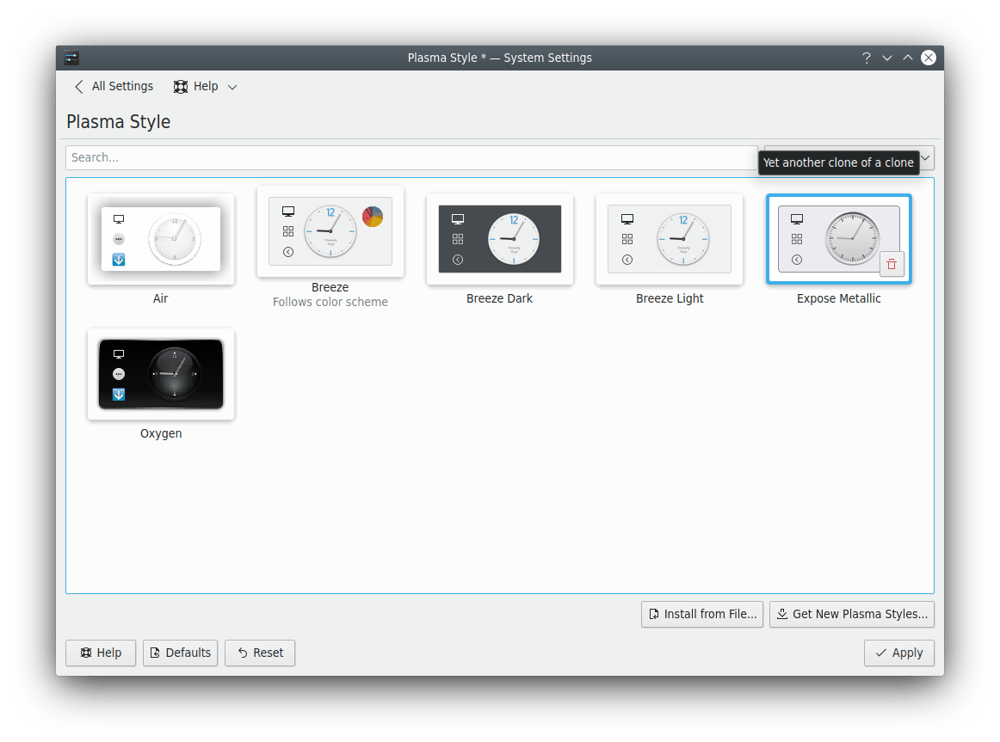
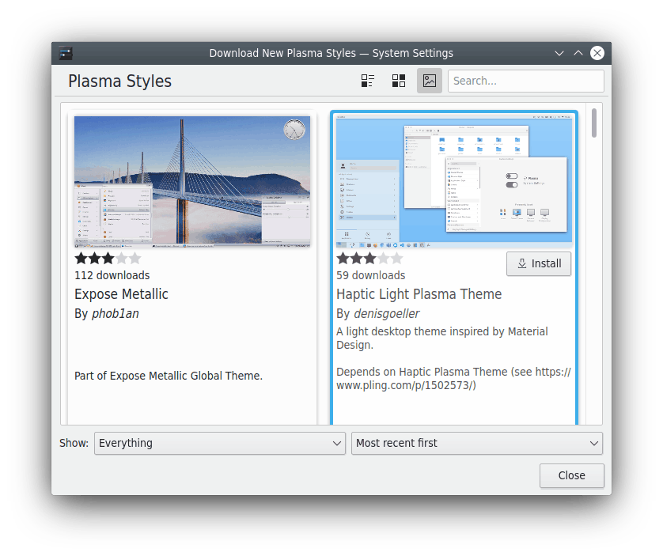

# Desktop Style

The style defines how the parts of the desktop, such as panels and widgets, are displayed. In this module you can install, choose and remove styles. SonicDE comes with **Silver Light** and **Silver Dark**, which match the Silver window borders and application style.

You can filter the list with the search field, and the box next to it shows **All themes**, **Light themes**, **Dark themes** or **Color scheme compatible** themes. Styles that take their colors from your [color scheme](colors.md) say **Follows color scheme** under their name.

Hover over a style to reveal its remove button. To undo it, click the undo button. Styles marked for removal are deleted when you click **Apply**, and you can't undo that. You can't delete system-installed styles or the active one.

If the [Plasma Theme Explorer](../applications/theme-explorer.md) from the `sonic-theme-sdk` package is installed, hovering over a style also offers **Edit Theme…**, which opens the style in it.

For more technical information, see [Understanding desktop themes](../../developer/plasma/theme/details.md).

- **Get New…:** Needs an Internet connection. It opens a dialog to choose a new style. Click **Install** on one, and your new style is available as soon as you close the dialog.
- **Install from File…:** Opens a file dialog to point to a style you've downloaded, as a `.zip`, `.tar.gz` or `.tar.bz2` file. It's then installed and added to the list.

## Configuring the desktop style

**Configure Desktop Style…** has settings for styles that support them, such as Silver Light and Silver
Dark. Other styles keep their own look, and the page says so when one of them is selected.

### Transparency

How see-through the desktop is.

- **Use these settings instead of the desktop style's own:** Turns the settings below on. Moving a
  slider turns it on for you.
- **Panels**, **Pop-ups**, **Tooltips** and **Desktop widgets:** How transparent each one is, from
  **Transparent** to **Opaque**. Pop-ups include their top and bottom bars, such as the search field
  and buttons in the application launcher. Desktop widgets are only see-through while the Blur desktop
  effect is on.

Changes show straight away when you click **Apply**.
