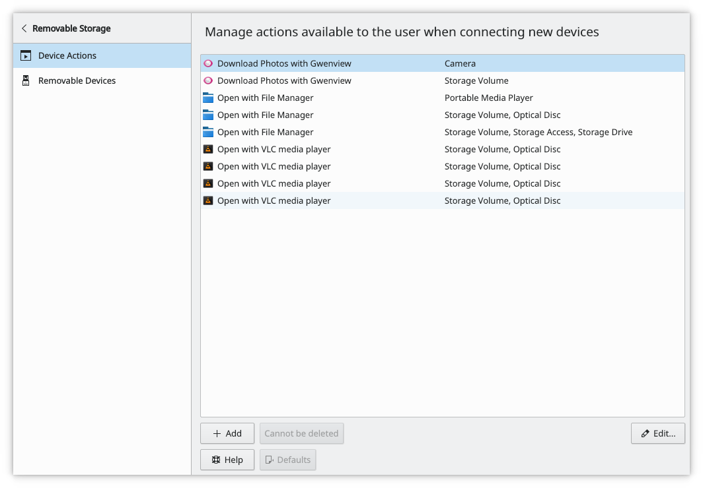
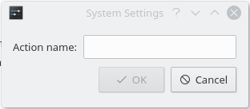
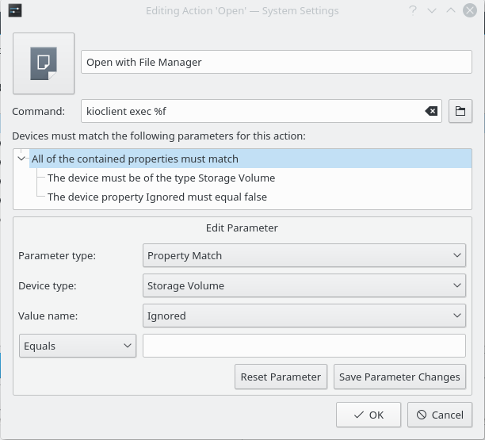

# Device Actions

This module sets up the actions offered when you plug in new devices. It lists all the possible actions, which are only available under certain conditions.

- **Add…:** Asks for a name for your new action, then opens it for editing. If you don't supply all the required details, the action is deleted.
- **Edit…:** Changes the name, icon, command and the conditions the action must match to be shown.
- **Remove:** Depends on where the action came from. Actions you created are completely removed. For an action supplied with your system you can only discard your changes, and if there are none, it shows **Cannot be deleted**.

## Adding an action

**Add…** asks for the new action's name:

The name should describe the action. After you enter a name and click **OK**, the edit dialog opens so you can set up the action.

## Editing an action

This dialog changes the settings of the action you selected:

It includes the icon, which you change by clicking it, the action name, the command and the parameters. The parameters are displayed in a tree, and the top item has to be true for the action to be shown.

### Edit Parameter

- **Parameter type:** What's contained in the parameter, or what matching is done to check if it's true:
  - **Property Match:** Compares a property of the device, using **Device type** and **Value name**, against the text you provide.
  - **Content Conjunction:** All sub-properties must be true for this to be true.
  - **Content Disjunction:** Any sub-property may be true for this to be true.
  - **Device Interface Match:** Checks whether the device can be classed as the selected device type.
- **Device type:** The device types your system supports. They're used in both property and device interface matches.
- **Value name:** All possible property names for the selected device type. Next to it you choose **Equals** or **Contains** and enter the text to compare with.
- **Reset Parameter:** Reverts unsaved changes to this parameter.
- **Save Parameter Changes:** Saves your changes to the parameter.
