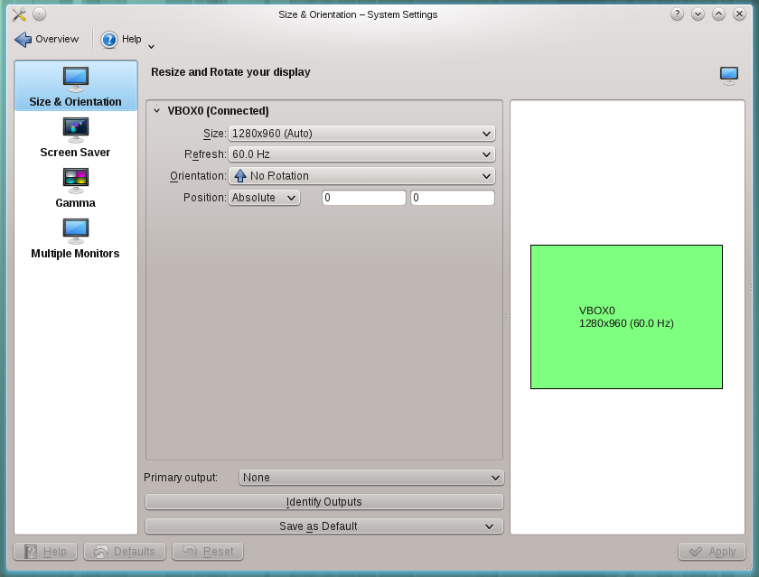

# Display Configuration

Here you can configure the physical characteristics of your screens, such as their size and orientation, and how several monitors are arranged.

After you apply a change, the module asks you to keep the new configuration. If you don't answer, it goes back to the previous one after a few seconds, so an unusable setting can't leave you stuck.

These related modules sit next to it in the **Display & Monitor** category:

- [Gamma](monitor-gamma.md) tweaks the way your monitor displays colors.
- [Screen Locking](screen-locking.md) sets when the screen locks.
