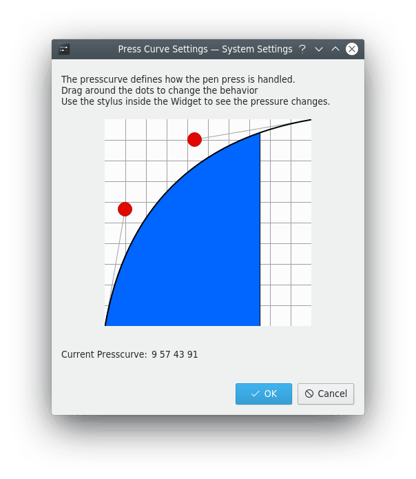
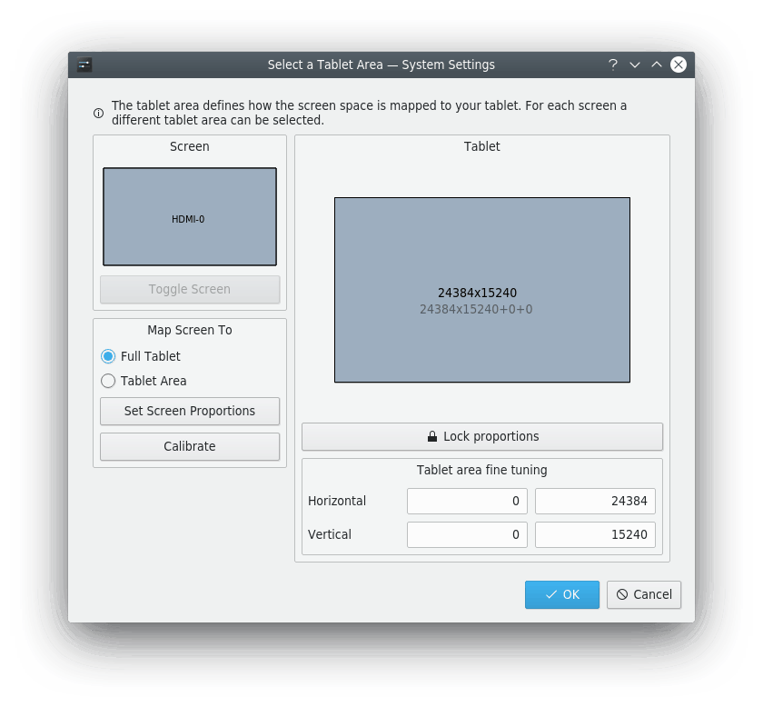

# Drawing Tablet

This module handles all the settings for your graphic tablet. It handles all tablets supported by the [Linux Wacom driver](https://linuxwacom.github.io) project. Make sure your tablet is detected, either through `xorg.conf` or udev, and works in general. See [Tablet detection](#tablet-detection) for more.

> [!IMPORTANT]
> The `xf86-input-wacom` driver must be installed, and `xsetwacom` must be available, for this module to work correctly.

The module is split into pages that handle all aspects of your tablet and pen: [General](#general), [Stylus](#stylus), [Express Buttons](#express-buttons), [Tablet](#tablet) and [Touch](#touch). **Express Buttons** and **Touch** only appear if your tablet has them.

## Profiles

**Select Tablet** chooses which tablet you're configuring, and **Select Profile** its profile. The two buttons next to it create a new profile and delete the current one. Each profile is saved for the connected tablet. A new profile starts with the default settings returned by the driver.

You can use different profiles for your settings, for example one when using the pen as a mouse replacement for your day to day work, and one for drawing.

You can change a profile on the fly, and it directly changes how your tablet behaves.

> [!NOTE]
> The [tablet daemon](#tablet-daemon) must be running in the background to change the profiles and apply them to the tablet. It does all the work, and the module only changes the profile settings for it.

If your tablet isn't recognized, **Manually register a tablet device** opens a tool that asks you to describe your device.

## General

This page shows general information about the detected tablet: its name and company, an image, and all the detected input devices.

> [!NOTE]
> The tablet must be connected and the [tablet daemon](#tablet-daemon) must be running for the module to work correctly. See [Detection problems](#detection-problems) for further help.

The page also sets global shortcuts, each of which changes the options for the connected tablet. **Profile rotation** chooses the profiles that a shortcut moves through, with **Add**, **Remove**, **Up** and **Down**.

## Stylus

The pen has two sides: the main side is the stylus, and the other end is the eraser. On this page you can change every aspect of the pen, from the button assignments to the pressure curve and threshold.

- **Eraser Feel:** The slider changes the eraser's threshold. For finer control, change the whole pressure curve with **Edit Pressure Curve…**. See [Press curve dialog](#press-curve-dialog).
- **Button Settings:** Changes the action of each pen button. Clicking the edit box opens a dialog where you can select key combinations, modifier keys and mouse buttons. With **Tap to execute action**, the stylus must be touching the tablet for a button's action to run. Otherwise, each button also works while the stylus hovers above the tablet.
- **Tip Feel:** The slider changes the stylus tip's threshold. For finer control, change the whole pressure curve with **Edit Pressure Curve…**.
- **Raw Sample Rate** and **Suppress Rate:** Set how many raw data points are used to filter the pen's position, and how many points are trimmed.

## Express Buttons

This page sets the actions for all the tablet's hardware buttons, and for its wheel, touch ring and touch strips if it has them. To change an action, click the edit box and choose it in the dialog.

## Tablet

This page sets further properties of the tablet area when used with a pen: its orientation, the space used and the tracking mode.

### Stylus Tracking Mode

- **Map to Screen (Absolute Mode):** Maps the pen's cursor with absolute movement. The edges of the tablet directly represent the space of the screen.
- **Map to Cursor (Relative Mode):** Maps the pen's cursor with relative movement.

### Orientation

This box sets how the tablet area is rotated. Choose a rotation yourself, or with **Auto-Rotate with Screen** the tablet rotates together with the screen. It does this by listening for the xrandr events sent when the screen rotates.

If the tablet always rotates in the wrong direction, enable **Invert Auto-Rotation**.

### Tablet Mapping

This sets the proportions of the tablet used for each screen, which keeps the tablet area proportional to the screen space in absolute tracking mode. See [Area selection dialog](#area-selection-dialog).

> [!NOTE]
> This doesn't work in relative mode.

## Touch

This page sets further properties for the touch part of the tablet. **Enable Touch** turns touch on or off, and a global shortcut can do this too.

### Touch Tracking Mode

- **Map to Screen (Absolute Mode):** Maps the touch cursor with absolute movement. The edges of the tablet directly represent the space of the screen.
- **Map to Cursor (Relative Mode):** Maps the touch cursor with relative movement.

### Gestures

With **Enable Gestures**, the tablet can generate gesture events for the touch device. Enabling this may break touch input using a touchscreen.

- **Scroll Distance:** Placing two fingers on the tablet and moving them up or down scrolls through windows. The distance is in tablet units, and **Invert Scroll Direction** reverses the scrolling.
- **Zoom Distance:** Moving two fingers together or apart zooms in or out. The distance is in tablet units.
- **Tap Time:** The time in milliseconds for a double tap to count as a right click.

### Touch Mapping

This sets the proportions of the touch device used for each screen, which keeps the area proportional to the screen space in absolute tracking mode. See [Area selection dialog](#area-selection-dialog).

> [!NOTE]
> This doesn't work in relative mode.

## Press curve dialog

The press curve defines how the stylus's pressure is translated. It's defined by four points of a Bézier curve. To change it, move the red dots.

> [!NOTE]
> Use your pen inside the dialog to see the changes directly. A blue area below the curve shows the applied pressure of the pen.

## Area selection dialog

This dialog sets the available tablet area for each selected screen space. To keep the tablet's aspect ratio, you need to reduce the tablet area depending on the screen resolution. You can set this for each screen individually.

**Toggle Screen** switches between full screen, meaning all connected monitors, and each individual monitor. The settings are saved for each screen configuration, and applied to the tablet whenever the global shortcut switches the screen.

You can map the screen to the **Full Tablet** or just a defined **Tablet Area**, in the tablet pane on the right. **Lock proportions** locks or unlocks the area's proportions.

To keep the tablet's aspect ratio with the current screen selection, press **Set Screen Proportions**, and the tablet area is calculated and changed automatically.

**Calibrate** opens a dialog to calibrate your tablet by tapping four points on the screen.

When the dialog closes, the last selected screen is used. You can switch screens later with the global shortcut.

> [!NOTE]
> The tablet area only works in absolute tracking mode for the touch and pen cursors. In relative mode, the full tablet is used.

## Tablet daemon

The tablet daemon runs in the background and does the groundwork: it detects the tablet and sets it up with the selected profiles. If it isn't running, the module and the widget can't work properly, and the tablet can't use the profiles.

### Tablet detection

Should your tablet not be found, check with `xsetwacom list devices`, `lsusb` and `xinput --list`. If none of them show its name, it isn't supported and can't be used by this module.

### Detection problems

If the tablet isn't detected, check whether it's supported on the [Linux Wacom driver](https://linuxwacom.github.io) or [DIGImend driver](https://digimend.github.io) pages. Also check with `lsusb` that you can find your tablet.

If udev doesn't handle the detection, add the tablet to your `/etc/X11/xorg.conf.d/50-tablet.conf` file, creating it if it doesn't exist, and restart the X server.

For a serial device, such as a Tablet PC, check that `xinput --list` shows your input devices (stylus, eraser, pad). If so, look up the internal tablet device ID with `xsetwacom get "Name of your pad or stylus" TabletID`.

If your device can be set up through `xsetwacom` but isn't recognized by the module, **Manually register a tablet device** can add it.

## Tablet widget

The widget makes it possible to change profiles on the fly. You can also change the pad's rotation, turn touch on or off, and switch between absolute and relative mode for the stylus and eraser, regardless of the current profile settings.

You don't need the widget for this module to work. The tablet daemon activates the default profile as soon as it detects your tablet. The widget is just a visual helper for switching easily between profiles.
