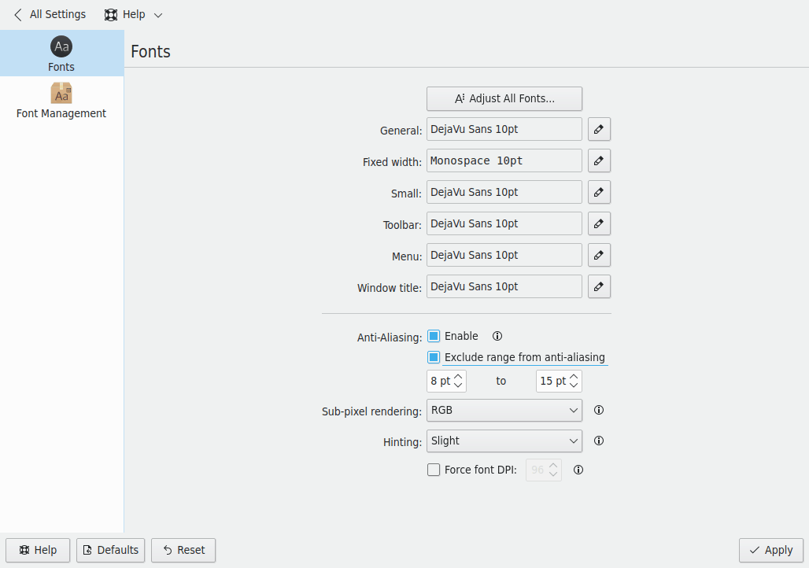
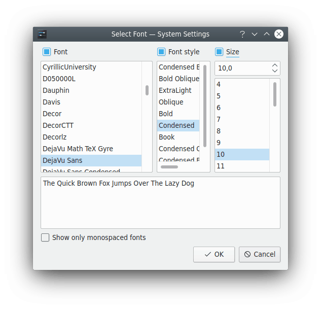

# Fonts

This module lets you select fonts for different parts of the desktop.

- **General:** Used everywhere the other groups don't apply.
- **Fixed width:** Used wherever a non-proportional font is specified.
- **Small:** Used where small fonts are needed.
- **Toolbar:** Used in application toolbars.
- **Menu:** Used in application menus.
- **Window title:** Used in the window title.

Each group shows an example of its font and has a button to choose another, with a font, style and size. **Show only monospaced fonts** filters the list. See [Choosing a font](../dialogs/font-chooser.md) for the whole window, including font features and the sample text.

The module warns you when one of the chosen fonts is a “Display” font, which isn't meant for use on computer screens and may look odd. Sizes below 4pt aren't supported: the module resets them to 4pt and says so.

Very large or very small fonts may look odd. The recommended way to scale the interface is the global screen scaling feature, which **Adjust Global Scale…** takes you to.

**Adjust All Fonts…** quickly sets properties for all the fonts above. It opens a similar dialog with checkboxes to change the **Font**, **Font style** or **Size** independently, and whichever you choose is applied to all the groups. See [Choosing a font](../dialogs/font-chooser.md).

For example, if you've chosen several different fonts and realize they're all a size too big, which often happens when you change screen resolution, you can apply a new size to all of them without affecting your fonts and styles.

## Anti-aliasing

**Anti-Aliasing** turns on smoothing of font edges.

**Exclude range from anti-aliasing** lets you specify a range of font sizes that aren't anti-aliased, using the two boxes below it.

You can also set the method and strength of anti-aliasing with [sub-pixel rendering](https://en.wikipedia.org/wiki/Subpixel_rendering) and [hinting](https://en.wikipedia.org/wiki/Font_hinting). If you aren't familiar with these, leave them alone.

- **Sub-pixel rendering:** **None**, **RGB**, **BGR**, **Vertical RGB** or **Vertical BGR**. On flat screens each pixel is made of smaller colored lights, and text looks sharper when this matches the order of those lights on your screen. Most screens use RGB. It doesn't help on CRT monitors.
- **Hinting:** **None**, **Slight**, **Medium** or **Full**. Hinting uses hints built into a font to make it look better, especially at small sizes. Stronger hinting gives sharper edges, but small letters look less like their shape at large sizes.

## Font DPI

**Force font DPI** uses a DPI other than your system's. You can check what DPI your X server is set to by running `xdpyinfo | grep resolution` in a terminal.

Some changes, such as anti-aliasing and DPI, only affect newly started applications.
