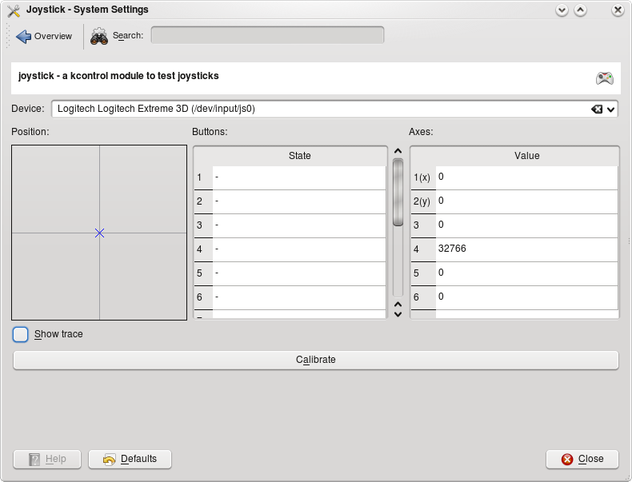
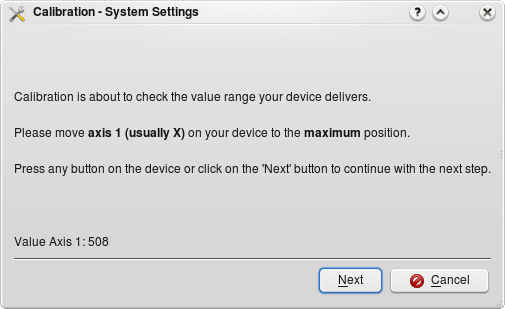

# Game Controller

This module lets you test and calibrate your game controller, and see which functions on it are mapped to which button or axis. If no controller is found, it asks you to connect a wired or wireless one.

## Testing a controller

- **Device:** If you have more than one game controller, select which one to look at. The module also shows the **Device type**, **Connection type** and **Controller type**.
- **Left position** and **Right position:** The plotted positions of the sticks.
- **Buttons:** The pressed state of the buttons. When a button is pressed, PRESSED appears next to it, so you can check that it's mapped correctly.
- **Axes:** The numerical values of the axis positions.

> [!TIP]
> If a stick can't reach every point on the graph, or doesn't center correctly, you need to calibrate your device.

The system may go to sleep or lock the screen while you're using a controller. If it does, consider blocking them manually while you play.

## Calibrating

Click **Calibrate** and follow the steps:

1. Keep all sticks centered and controls released.
2. Move every stick and axis through its full range.
3. Click **Finish** to apply and save the calibration.

**Cancel** stops without changing anything, and **Reset Calibration** returns to the original calibration.

## Using a controller as a pointer and keyboard

**Allow using as pointer and keyboard** lets game controllers act like pointer and keyboard devices on the desktop and in non-game applications. Games can always use the controller.
