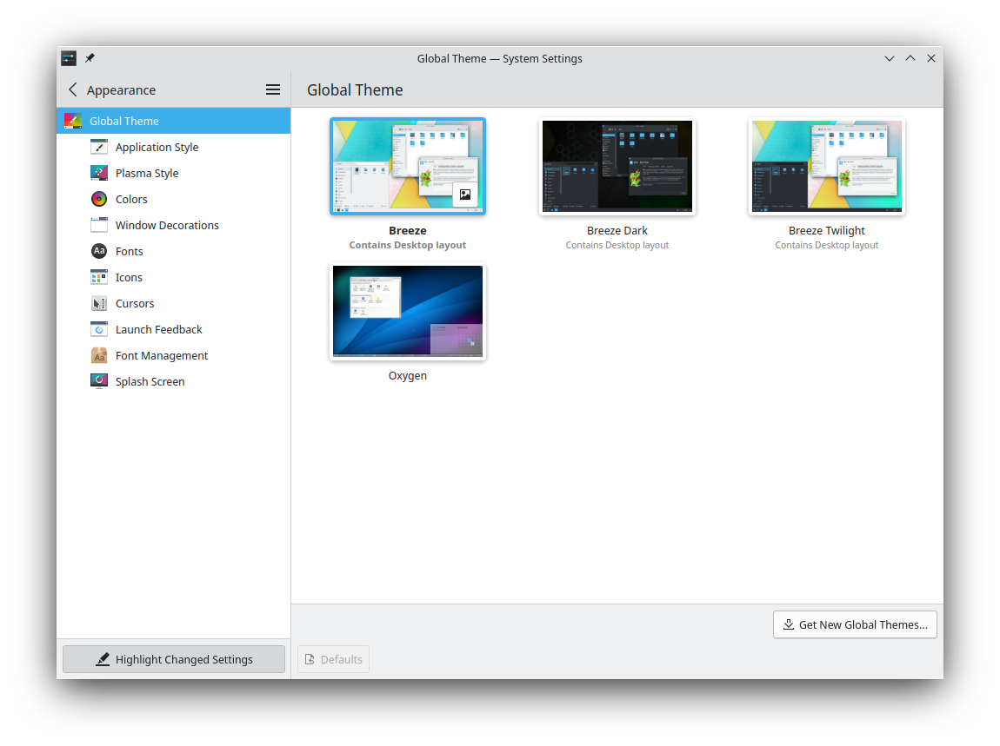
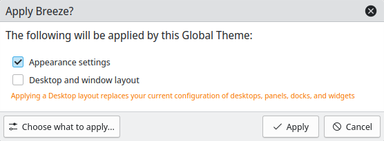
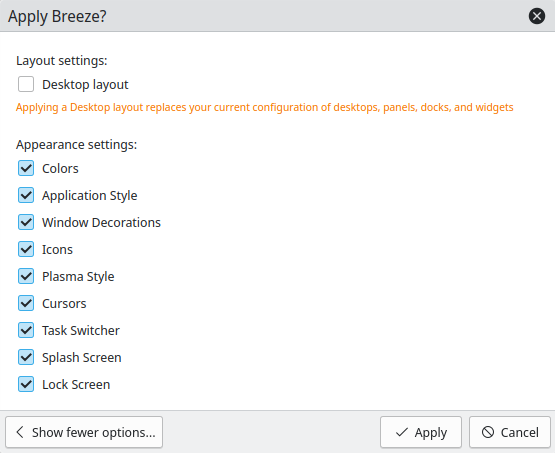
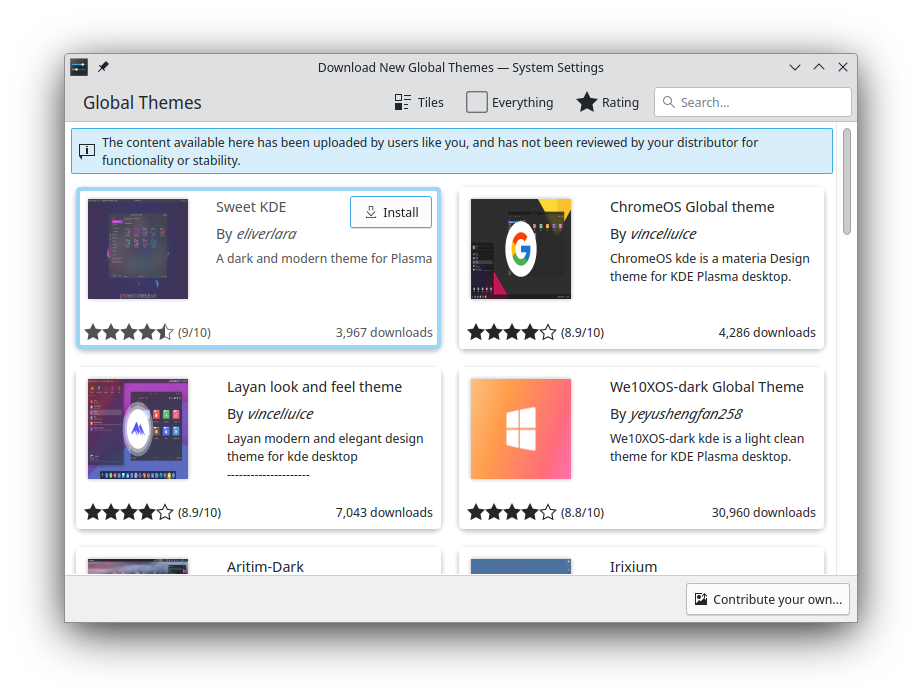

# Global Theme

Global themes provide a common look and feel for many components at once:

- **Desktop layout:** An arrangement of panels and widgets, for example a bottom panel with a task manager and application launcher.
- **Colors:** The color palette used throughout the desktop and applications.
- **Application Style:** The appearance of interface elements such as buttons, menus and scroll bars.
- **Window Decoration Style**, **Window Decoration Size** and **Titlebar Buttons layout:** Window borders and titlebar buttons.
- **Icons:** The icons used throughout the desktop and applications.
- **Desktop Style:** The appearance of panels and widgets.
- **Pointers:** Mouse pointers.
- **Fonts:** The fonts used throughout the desktop and applications.
- **Task Switcher:** The overlay for switching between open windows, usually opened with Alt+Tab.
- **Splash Screen:** The loading screen shown when the desktop starts.

Applying a global theme can change all of these together, or only some of them. You can also apply individual components using the other System Settings modules.

## Applying a global theme

Click a theme and a dialog asks which parts to apply: **Appearance settings** and **Desktop and window layout**.

> [!WARNING]
> Applying a desktop layout deletes your current set of desktops, panels, docks and widgets, and replaces them with the theme's.

**Choose what to apply…** shows every component, so you can choose them individually.

Click **Apply** to confirm your choice.

## Switching to dark mode at night

**Switch to Dark Mode at Night** uses one global theme during the day and another at night. Choose the **Light** and **Dark** themes, and **Configure Day/Night Cycle…** sets the times.

**Wait until idleness before switching** waits until the computer has been idle for a set time, so the theme doesn't change while you're working.

## Saving your own theme

**Save Current Theme…** saves your current appearance and theme settings as a new global theme. Give it a name, and add a preview image or take a screenshot.

## Installing and removing themes

**Get New…** installs new global themes from third-party providers, which needs an Internet connection. Click **Install** on a theme, and it's available as soon as you close the dialog.

To remove a theme, hover over its thumbnail and click the trash button. You can only remove themes you've installed yourself.

If you'd like to create your own theme, see [Themes and plugins](../../developer/plasma/index.md).
