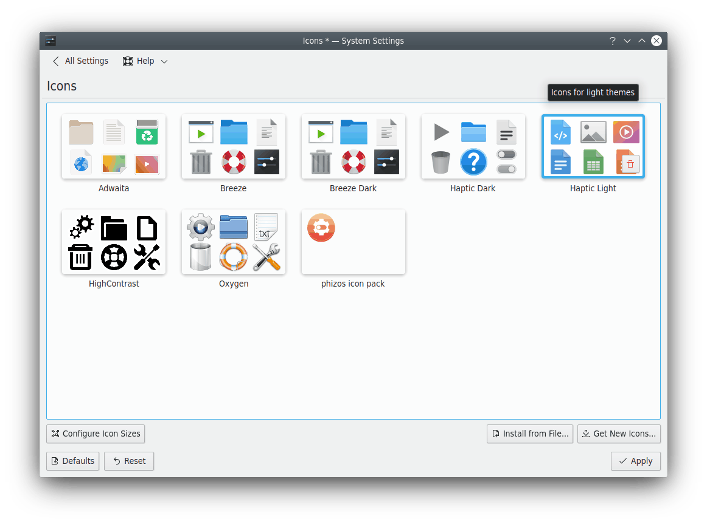
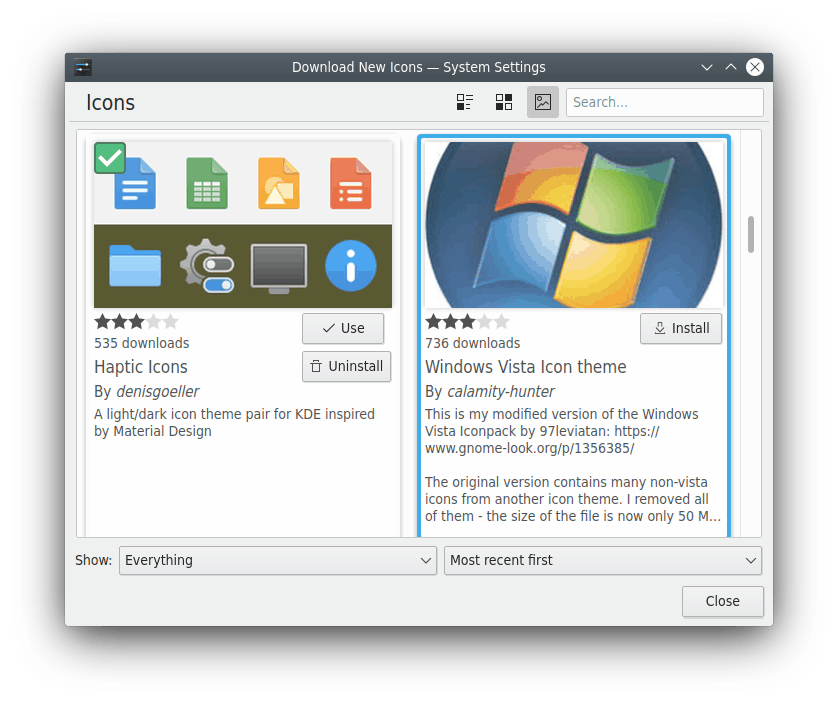
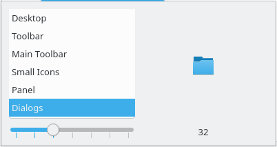

# Icons

Icons are used all over the desktop: on the desktop itself, in panels, in the file manager and in application toolbars. In this module you can install, choose and remove icon themes.

Each theme in the grid shows a few of its icons. Hovering over a theme animates its preview through a selection of its icons.

SonicDE's own icon themes are **Silver** and **Silver Dark**. The light [Silver global themes](global-theme.md#the-silver-themes) use Silver and the dark ones Silver Dark, and applications use Silver when no icon theme has been chosen. **Breeze** and **Breeze Dark** are an optional extra from the `sonic-breeze` package; they build on the Silver icons.

Hover over a theme to reveal its remove button. To undo it, click the undo button. Themes marked for removal are deleted when you click **Apply**, and you can't undo that. You can't delete system-installed themes or the active one.

- **Get New…:** Needs an Internet connection. It opens a dialog to choose a new icon theme. Click **Install** on one, and your new theme is available as soon as you close the dialog. See [Getting new add-ons](../dialogs/get-new-stuff.md) for the window's filters, sorting, updates and uninstalling.
- **Install from File…:** Opens a file dialog to point to a theme you've downloaded, as a `.tar.gz` or `.tar.bz2` file. It's then installed and added to the list.

This older screenshot shows a dialog for icon sizes, which is no longer in the module:

