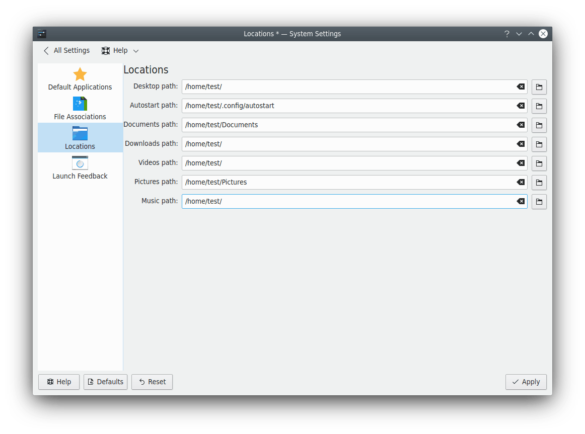

# Locations

This module configures the essential folders of your desktop. Each one has a button to choose a new location.

> [!NOTE]
> Drives that are automounted at login can't be used as paths. Such drives are reverted to defaults when the desktop restarts.

- **Desktop folder:** Contains all the files you see on your desktop. It's usually `~/Desktop`.
- **Documents folder:** Used by default to open and save documents.
- **Downloads folder:** Used by default to save your downloaded items.
- **Videos folder:** Used by default to open and save video files.
- **Pictures folder:** Used by default to open and save image files.
- **Music folder:** Used by default to open and save music files.
- **Public folder:** Used by default for publicly shared files when network sharing is turned on.
- **Templates folder:** Used by default to open and save file templates.
- **Projects folder:** Used by default to open and save projects.
