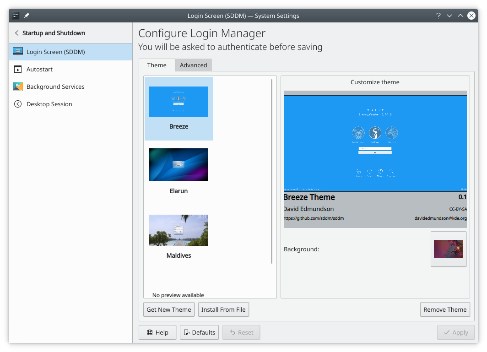

# Login Screen

This module configures the login procedure of Sonic Login Manager.

## Convenience

If you don't want to type your username and password when logging in, choose **Automatically log in**, then select the user and the session to start, and click **Apply**. Remember that anyone who can physically reach your computer then has instant access to all your data, so weigh up the risk before using this.

## Desktop settings

**Apply Desktop Settings…** makes the login screen reflect your own customizations, such as your language and locale settings and keyboard layout. Selected user-installed themes and customizations are copied to the login screen. **Reset to Default Settings** undoes this.

**Configure Appearance…** changes how the login screen looks.
