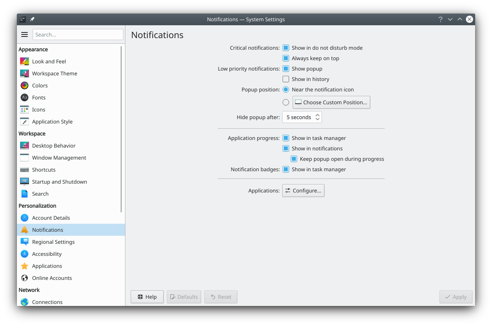

# Notifications

The desktop and applications need to tell you when a problem occurs, a task is completed or something has happened. This module sets how they do that.

## Do Not Disturb mode

This mode turns off all visual and most audible notifications so you can focus on your current task.

**Enable automatically:**

- **When screens are mirrored**, for example during a presentation.
- **During screen sharing**, for example during an online lecture.
- **While a fullscreen application is focused**, for example watching a video.
- **During time period**, between a **Start time:** and **End time:** you set. Notification sounds are silenced when the current time is within this period, including the start and end times. An end time earlier than the start time means the next day.

**Manually toggle with shortcut:** is a global shortcut to turn the mode on and off at any time.

## Visibility conditions

- **Critical notifications:** **Show in Do Not Disturb mode** shows notifications such as a nearly empty battery, even in Do Not Disturb mode.
- **Low priority notifications:** **Show popup** and **Show in history** set whether ones such as media track changes appear as popups or in the history.

## Popups

- **Location:** **Near notification icon** shows popups close to the notification icon in your panel. **Choose…** picks a fixed screen corner.
- **Hide after:** How many seconds until a popup disappears, between 1 and 120.
- **Show timeout indicator:** Shows a progress bar on notifications, indicating when they'll hide.

## Additional feedback

- **Application progress**, such as copying or downloading a file:
  - **Show in notifications** shows a popup during the progress.
  - **Keep popup open during progress** keeps it visible for the whole time, rather than hiding it automatically. It's always shown again when the task finishes or fails.
- **Notification badges:** **Show in task manager** lets applications show badges, such as an unread message count, in the panel.

## Application settings

**Configure for Applications…** opens a page to set notification behavior for each application or service, and **Configure for System…** goes to the system's own. Use the list to choose an entry under **Applications** or **System Services**.

General warning popups and startup and shutdown sounds are under the Plasma Workspace service. Applications that don't identify themselves properly, such as shell scripts, can be configured with the **Other Applications** entry.

- **Show popups:** Whether this application may show popup notifications.
- **Show in do not disturb mode:** Whether it may show them even in Do Not Disturb mode.
- **Show in history:** Whether its notifications are kept in the history.
- **Show notification badges:** Whether it may show badges in the panel.
- **Configure Events:** For applications that support it, sets each notification individually, with **Show a message in a pop-up** and **Play a sound**. For a sound, you can type the path of a sound file, pick one with **Choose sound file**, listen to it with **Preview sound**, or go back to the event's default sound with **Reset**.
