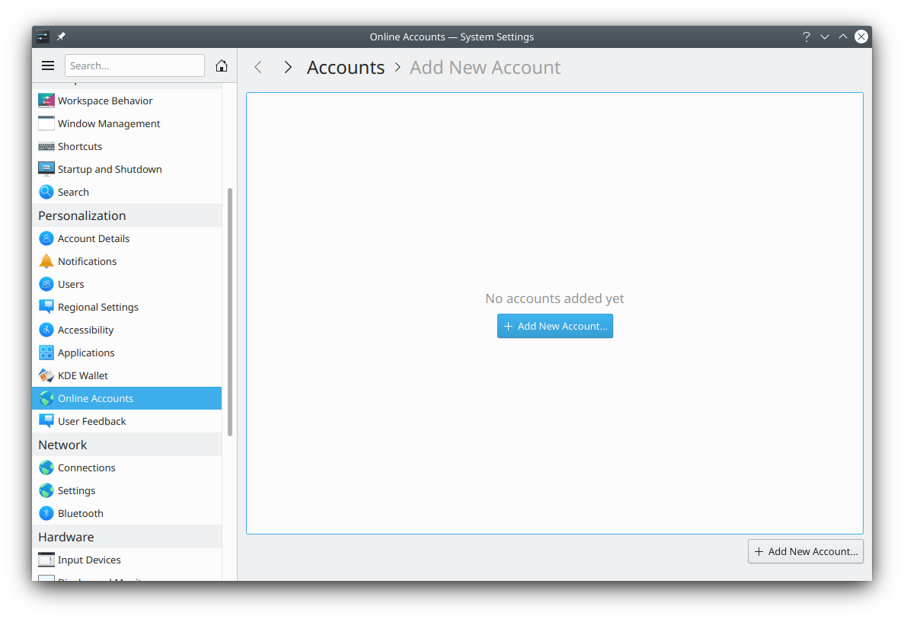

# Online Accounts

This module lets you connect online accounts to your desktop, to provide better integration. Click **Add Account…** to add one. Each account can then be renamed or removed.

> **Note:** On some distributions no providers are found. In that case, you need additional provider packages from your distribution.
