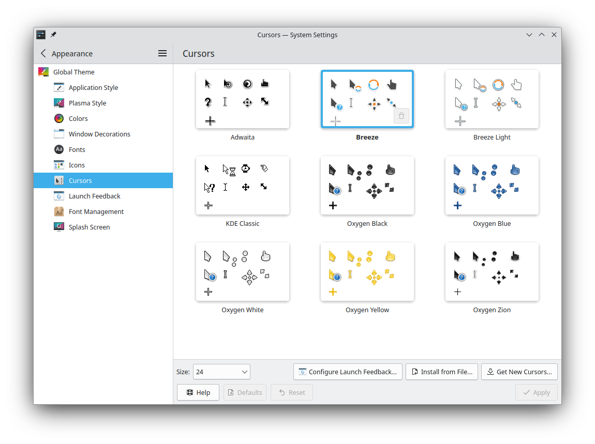
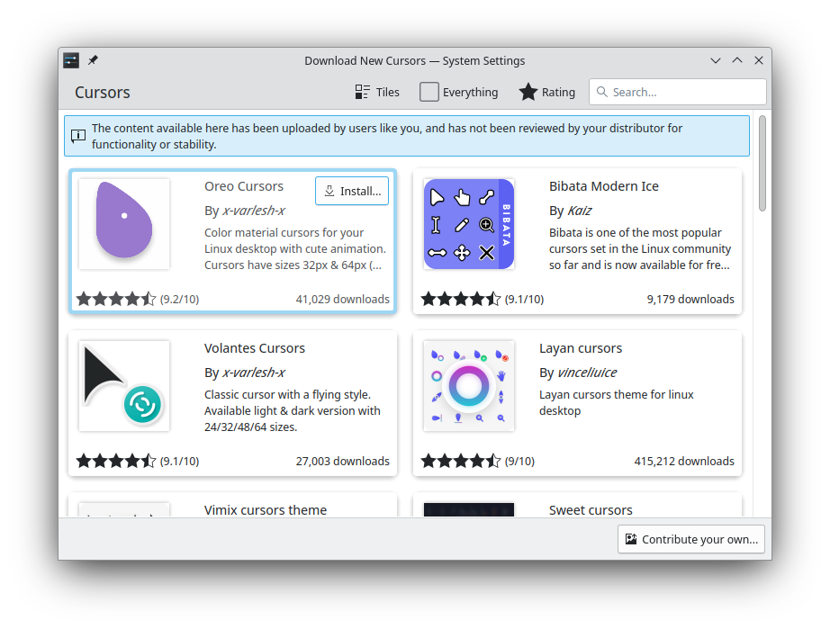
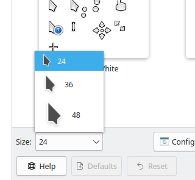
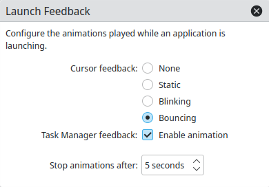
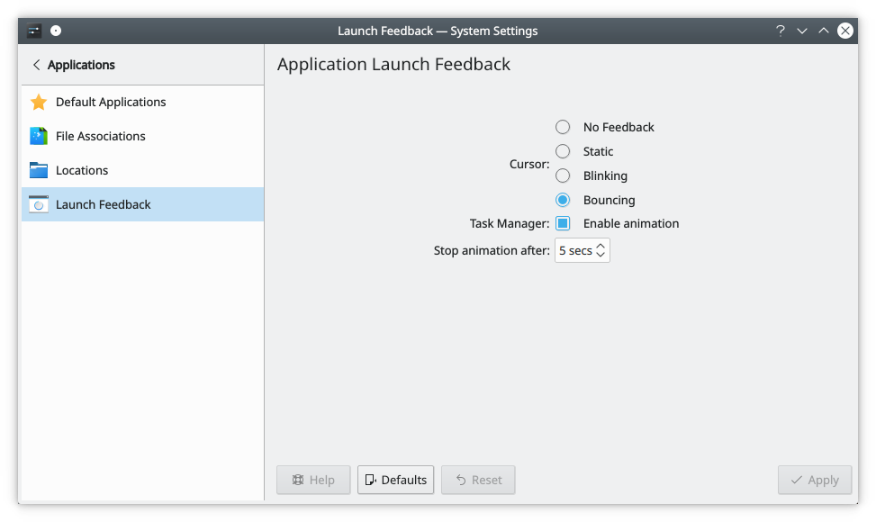

# Pointers

This module lets you select a pointer theme and configure an animation for launching applications. Some features may not be available on some systems.

## Pointer themes

To use a pointer theme, select it and click **Apply**.

Hover over a theme in the list to reveal its remove button. You can't remove system-installed themes or the active one.

**Get New…** downloads more themes from the Internet, and **Install from File…** installs theme files you've downloaded or otherwise obtained.

If you'd like to create your own theme, see [Create your own mouse cursor theme](../../developer/additional/cursor-theme.md).

## Pointer size

Some themes let you choose a size. Use the **Size** field to select it.

## Launch feedback

Sometimes it's reassuring to know your computer didn't just ignore you and something is happening behind the scenes. **Configure Launch Feedback…** sets the visible feedback when you start an application.

- **Pointer feedback:** Attaches an icon to the pointer for a short time while an application launches. Choose **None**, **Static**, **Blinking** or **Bouncing**, which is the default.
- **Task Manager feedback:** **Enable animation** gives a starting application an immediate entry in the task manager, with an animation to show something is happening.
- **Stop animations after:** How long the feedback lasts, 5 seconds by default. Not every application eventually shows a window or a task manager entry: some dock in the system tray, for example. This timeout makes sure you still get feedback in those cases, and that it goes away.
