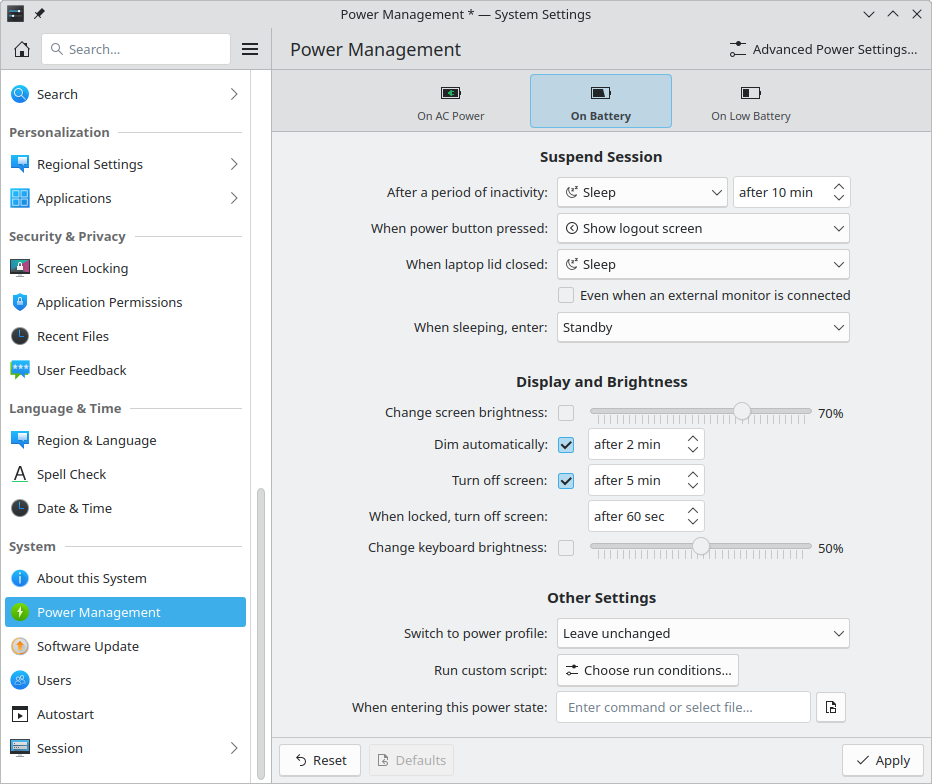
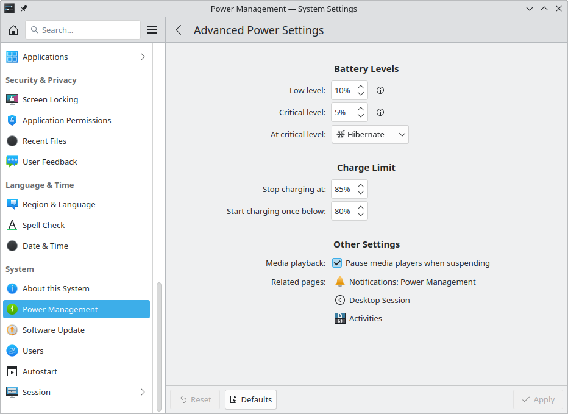

# Power Management

This module configures the desktop's power management service, PowerDevil. It lets you trade off saving energy against making full use of your system.

The main page shows settings that can help save energy, and only those your system supports. Battery-powered systems have three tabs with different settings for **On AC Power**, **On Battery** and **On Low Battery**.

## Suspend Session

There are common situations where you expect the system to sleep, shut down or pause your session in some way: after a period of inactivity, or when you press the power button or close a laptop lid. This section sets how your system behaves in each.

- **Do nothing:** Carry on as if nothing happened.
- **Sleep:** Save power and wake up quickly. Many hardware components enter a power-saving state without fully shutting down. Unsaved data is lost if the power supply is interrupted, for example when the battery runs out. How much power this saves depends on your hardware and firmware.
- **Hibernate:** Save the session to your storage drive and power off. It takes longer than standby, but unsaved data isn't lost if the power is interrupted. It's widely supported, as long as your drive has a large enough swap partition to store your system memory. It's also known as “suspend to disk”.
- **Shut down:** Log out of your session and any others, then power off. Open applications ask you to save any unsaved data before closing. Application state is only restored as far as each application supports it.
- **Lock screen:** Lock the screen without reducing power use. To save power too, select Sleep or Hibernate and turn on locking after waking in [Screen Locking](screen-locking.md). This is only available for the power button or laptop lid.
- **Show logout screen:** Show a dialog with options to sleep, hibernate, shut down or log out. This is only available for the physical power button.
- **Turn off screen:** Fade to black and turn off the display backlight.

Under the laptop lid setting, **Even when an external monitor is connected** runs the lid action even while another monitor is plugged in. When it's unticked, closing the lid does nothing as long as an external monitor is connected, so you can keep working on that monitor.

**When sleeping, enter** selects the exact mode:

- **Standby:** Saves the session to memory. It enters sleep and wakes up quickly. Battery-powered systems often last between a day and 1 to 2 weeks in this state. It's also known as “suspend to RAM”.
- **Hybrid sleep:** Saves the session to both memory and a storage drive. It wakes as quickly as standby, and unsaved data survives even if power runs out. It puts the most strain on your drive, potentially reducing its life, and takes longer to start sleeping. It's also known as “hybrid suspend”.
- **Standby, then hibernate:** Enters standby, then hibernates later. For short sleeps you get standby's quick wake-up and drive longevity, and for longer ones hibernation reduces power use further and keeps unsaved data safe. It's also known as “suspend, then hibernate”.

## Display and Brightness

Displays and keyboard backlights account for much of the power use of an otherwise idle laptop. Large monitors often use more power than a whole laptop, and some displays are susceptible to burn-in or stuck pixels. So it helps to reduce brightness or turn off displays and backlights when they aren't needed.

- **Change screen brightness** and **Change keyboard brightness:** Set a brightness level for each power state. You can also change brightness at any time with the desktop's brightness widget and keyboard shortcuts, which doesn't affect these settings. If no level is set here, brightness stays the same when the power state changes.
- **Dim automatically:** Reduces screen brightness after a period of inactivity. It returns to its previous level when you're active again.
- **Turn off screen:** Fades to black and turns off the backlight after a period of inactivity, and turns on again when you're active. You can set a shorter time for when the screen is locked.

### Displays without a backlight

Many external monitors don't let the computer change their brightness. On those displays, SonicDE dims the picture itself instead, so the brightness settings above, the brightness keys and the [Brightness & Color](../desktop/brightness-and-color.md) widget still work. Where a display does have hardware brightness control, that's used instead.

Software dimming works together with [Night Light](night-light.md): the two are combined rather than one replacing the other. Each display's level is remembered separately and comes back the next time you log in. The brightness slider never takes the picture completely black this way, so you can always see enough to turn it up again.

## Other Settings

- **Switch to power profile:** Sets the system's performance for each power state. A profile such as **Power Save**, **Balanced** or **Performance** trades performance against power use, which also affects heat and fan noise. **Leave unchanged** keeps whichever profile is active. You can also change it at any time with the [Power & Battery](../desktop/power-and-battery.md) widget and keyboard shortcuts, which doesn't affect this setting.
- **Run command or script:** A command or script to run when switching power states, or after a period of inactivity.

## Advanced Power Settings

**Configure Advanced Settings…** opens this page.

### Battery Levels

These only appear on battery-powered systems.

- **Low level:** Below this percentage, the charge is considered low. If the system is unplugged, the On Low Battery settings are used instead of On Battery.
- **Critical level:** Below this percentage, the charge is considered critical.
- **At critical level:** The action to take when the charge reaches the critical level.
- **Low level for peripheral devices:** Below this percentage, the charge of peripheral devices, such as a wireless mouse, is considered low.

### Charge Limit

These only appear if your system supports charge limits.

Regularly charging the battery close to 100% or fully discharging it can make it deteriorate faster. **Battery protection**, **Limit the maximum battery charge**, can help extend its life.

Sources recommend different charge levels for lithium-ion batteries. The general consensus is that keeping the battery between 25% and 75% is best for retaining its capacity over the years, and 15% to 85% still increases its life significantly compared to wider ranges. Lifespan is mainly affected by charge level over time, more than the number of charge cycles.

- **Stop charging at:** The upper limit. Once it's reached, the battery counts as fully charged and isn't charged any further.
- **Start charging once below:** The lower limit. Once the battery discharges past this, it starts charging again. This can be a little lower than the upper limit, or the same.

Some systems need the power cable unplugged and reconnected before these settings are respected, and some don't store them when powered off.

### Other advanced settings

**Media playback** can **Pause media players when suspending**. **Related pages** link to the relevant parts of other modules: [Notifications](notifications.md), [Shortcuts](shortcuts.md), [Screen Locking](screen-locking.md), [Desktop Session](session.md) and [Activities](activities.md).

## Using power management from KRunner

You can control power management through KRunner, which you open with Alt+F2, using these keywords:

- `screen brightness` or `dim screen` followed by a number, such as `screen brightness 50`: Sets the screen brightness to that percentage. `dim screen` on its own offers **Dim screen totally** and **Dim screen by half**.
- `sleep`, `suspend`, `power` or `to ram`: Offers **Sleep**.
- `hibernate` or `to disk`: Offers **Hibernate**.
- `hybrid sleep` or `hybrid`: Offers **Hybrid sleep**.

Each sleep mode is only offered if your system supports it.
