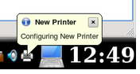
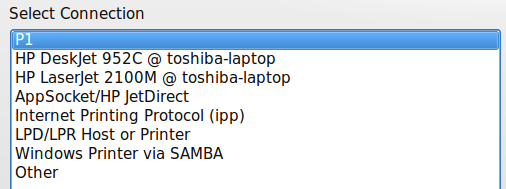
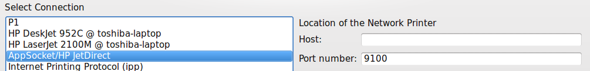

# Printers

Use this module to connect your computer to a printer and set up its options.

## Features

- Add a printer to your computer
- Give each printer a name that helps identify it
- Run printer tests and maintenance
- Remove a printer

> **Note:** USB printers plugged directly into the computer will probably be recognized and set up automatically. Even if you disconnect a USB printer, it stays in the list of printers.

When a printer isn't attached directly to your computer with a USB cable, you need to use this module to add it, such as when another computer shares a printer, or you want to connect directly to a printer on a print server.

## Example

These steps add a network-connected printer to your computer. These screenshots are older, and the screens look different now. First, gather your printer's information, such as its make, model and IP address.

1. Open this module, or use **Configure Printers…** in the Printers widget.
2. Click the button to add a printer. Your computer searches your local network for printers that are shared on other computers or attached directly to the network.

   In this example, an HP LaserJet 2100M is connected directly to the network through a small print server, and another computer shares two printers from a laptop. To use those two, the other computer has to be on. Remote printers work best if they're connected directly to the network or to a dedicated print server computer.

   

3. Choose the connection type, here **AppSocket/HP JetDirect**.

   

4. Enter the IP address in the **Host** field. Ask your network administrator if you don't know it.
5. Choose the manufacturer and the model.
6. Choose the recommended driver, unless you have a reason not to.
7. Give the printer a useful name.
8. Give a description, including its physical location if it isn't in your own room.
9. The location defaults to your computer's name, in case you decide to share it later.

The printer now appears in the list. If you have more than one printer, take care choosing a default. You might not want the big high-speed printer in the manager's office to be your default if you have a small one next to you.

> **Tip:** It's always wise to print a test page. **Configure…** opens a printer's settings.
