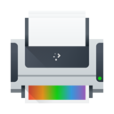

# Printers

Use this module, under **Connected Devices** in System Settings, to connect your computer to a printer and set up its options. Printing is handled by the CUPS print service; if it isn't running, the module says **Printing services not available**.

> **Note:** USB printers plugged directly into the computer will probably be recognized and set up automatically. Even if you disconnect a USB printer, it stays in the list of printers.

When a printer isn't attached directly to your computer with a USB cable, you need to use this module to add it, such as when another computer shares a printer, or you want to connect directly to a printer on a print server.

If a helper package for setting up printers is missing, a banner says so. **Install It** installs it, where your distribution supports installing software this way.

## The printer list

The module lists your **Printers** and **Printer Groups**. Each has buttons to:

- **Open Print Queue:** Shows the print jobs waiting for that printer in the [Print Queue](../applications/print-queue.md).
- **Pause** or **Resume:** Stops the printer taking jobs for now, or lets it start again.

Click a printer to open its settings.

The buttons at the top are:

- **Add…:** Adds a printer. See [Adding a printer](#adding-a-printer).
- **Add Group…:** Makes a printer group, which pools several printers: jobs sent to the group go to whichever member printer is free. It appears once you have more than one printer.
- **Configure Print Server…:** Opens the [CUPS Server Settings](#print-server-settings).

## Adding a printer

**Add…** opens **Set up a Printer Connection**, which looks for printers on your network and on your computer. **Refresh** looks again. **Show Manual Options** lists connection types to set up yourself, and **Show Detected Devices** goes back to the printers that were found.

The following steps add a network-connected printer. First, gather your printer's information, such as its make, model and IP address.

1. Open this module, or use **Configure Printers…** in the Printers widget.
2. Click **Add…**. Your computer searches your local network for printers that are shared on other computers or attached directly to the network.

   In this example, an HP LaserJet 2100M is connected directly to the network through a small print server, and another computer shares two printers from a laptop. To use those two, the other computer has to be on. Remote printers work best if they're connected directly to the network or to a dedicated print server computer.

3. Choose the connection type, here **AppSocket/HP JetDirect** from the manual options.
4. Enter the printer's IP address in the **Address:** field, and click **Continue with Address…**. Ask your network administrator if you don't know it.
5. Choose the manufacturer and the model, and the recommended driver, unless you have a reason not to.
6. Give the printer a useful **Queue Name:** and a **Description:**, including its physical **Location:** if it isn't in your own room.

The printer now appears in the list. If you have more than one printer, take care choosing a default. You might not want the big high-speed printer in the manager's office to be your default if you have a small one next to you.

> **Tip:** It's always wise to print a test page.

## Printer settings

Click a printer in the list to see and change its settings:

- **Default printer:** Makes this the printer applications use unless you choose another. To change the default, make another printer the default.
- **Share this printer** (or **Share this group**): Lets other computers on your network use it.
- **Accepting print jobs:** Untick it to make the printer turn new jobs away.
- **Print Test Page**, and, where the printer supports them, **Print Self-Test Page** and **Clean Print Heads**.
- **Queue Name:**, **Description:**, **Location:** and **Connection:**: The printer's name, description, where it is and how it's connected.
- **Make/Model:** The printer's driver. **Select…** chooses another.
- **Member Printers:** For a printer group, the printers in it.

**Apply** saves your changes. **Remove** deletes the printer or group, after asking you to confirm. **Configure…** opens the [Configure Printer](#configure-printer) window with more options.

## Configure Printer

The Configure Printer window, opened with **Configure…** in a printer's settings, has two pages.

**Media Settings** has the options of the printer's driver, such as paper size and print quality. Some printers also offer **Query Printer for Default Options**, which asks the printer for its own defaults. This page isn't shown for printer groups.

**Banners, Policies and Allowed Users** has:

- **Banners:** A **Starting Banner:** and **Ending Banner:** page printed before and after each job: **None**, **Classified**, **Confidential**, **Secret**, **Standard**, **Topsecret** or **Unclassified**.
- **Policies:** The **Operation Policy:**, **Default** or **Authenticated**, and the **Error Policy:**, which says what happens when a job fails: **Abort job**, **Retry current job**, **Retry job** or **Stop printer**.
- **Allowed Users:** Either **Prevent these users from printing** or **Allow these users to print**, with a list of users.

Settings for a printer shared from another computer can't be changed here.

## Print server settings

**Configure Print Server…** opens **CUPS Server Settings**:

- **Share printers connected to this system:** Lets other computers on your network print to your printers.
- **Allow printing from the Internet:** Also accepts print jobs from outside your local network. It needs sharing to be on.
- **Allow remote administration:** Lets other computers change this computer's printer settings.
- **Allow users to cancel any job (not just their own)**

**Apply** saves the settings; the print service restarts, which takes a moment. **CUPS Print Server Admin** opens the CUPS web pages for more options.

## The Printers widget

The Printers widget in the system tray lists your printers and the jobs they're working on. Each printer has **Pause** or **Resume**, and a menu with **Configure Printer…**, which opens that printer's settings in this module, and **View Print Queue**, which opens the [Print Queue](../applications/print-queue.md). Right-click the widget's icon for **Configure Printers…**, which opens this module.
