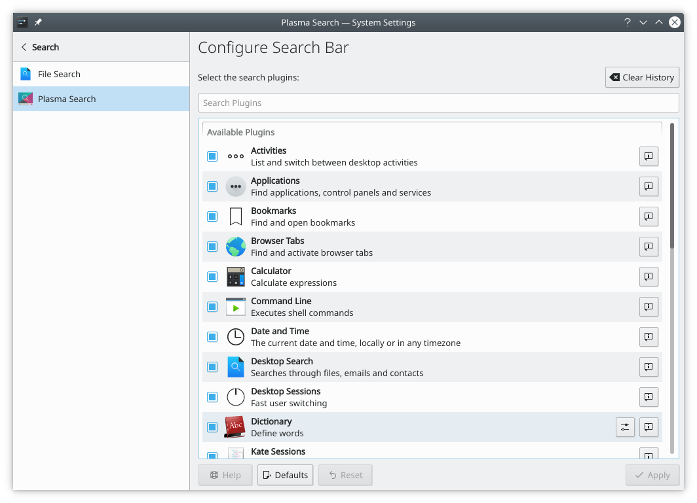

# Search

This module configures the search plugins used by [KRunner](../desktop/krunner.md) and the application launchers. You can enable or disable plugins and, where a plugin has them, open its settings. **Get New Plugins…** finds more.

**Configure KRunner…** sets:

- **Position on screen:** **Top** or **Center**.
- **History:** **Disabled**, **Enable suggestions** or **Enable auto-completion**. **Clear History…** removes the search history.

See [KRunner](../desktop/krunner.md) for everything it can do.
