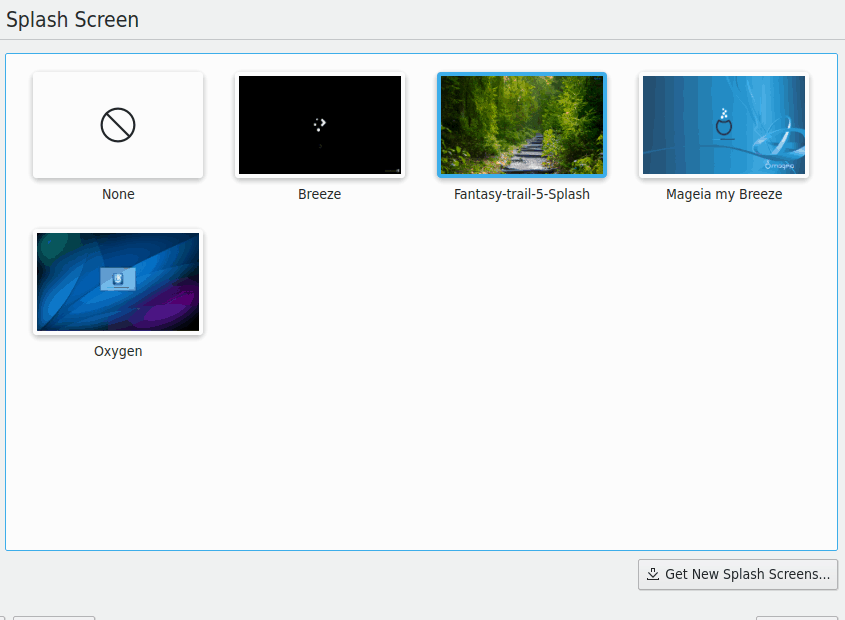
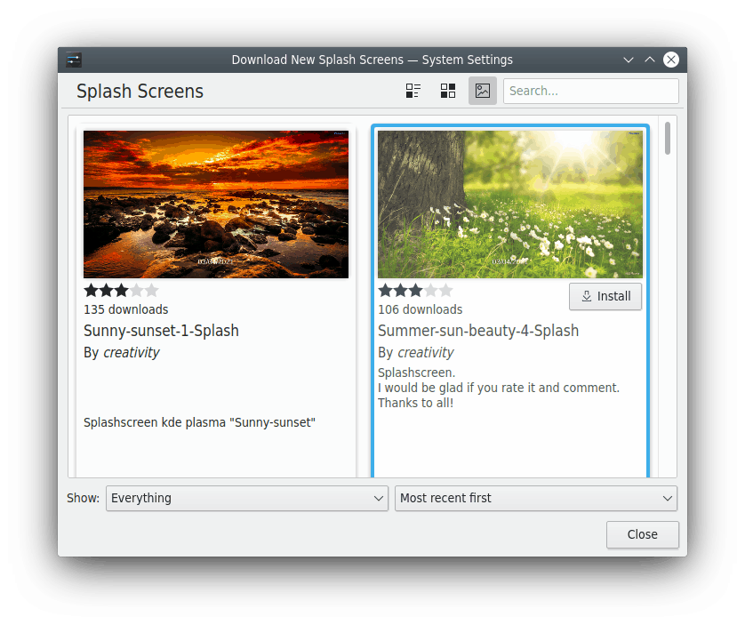

# Splash Screen

This module lets you view and select splash screen themes.

You can see previews of the installed splash screens, with the current one highlighted. Choose **None** if you don't want a splash screen.

Hover over a preview to reveal its buttons:

- **Preview splash screen** shows it in action.
- **Remove splash screen** deletes one you've installed. You can't delete system-installed splash screens or the active one.

**Get New…** shows a list of themes to download, which needs an Internet connection. Clicking **Install** on one installs it locally, and it's available as soon as you close the dialog. Click **Apply** to make it your current splash screen.

