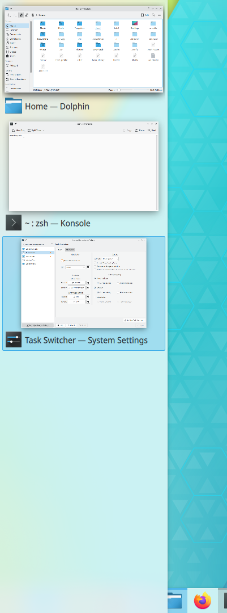

# Task Switcher

The Task Switcher lets you switch between open windows using the keyboard. You can configure its behavior, appearance, shortcuts and which windows it shows.

It's often opened with Alt+Tab, but you can change this. It shows a list of the open windows, filtered according to your settings. You can cycle forward and backward through the list by repeatedly pressing the shortcut. Releasing it activates the selected window.

Because there are so many options, you can define two sets of settings, **Main** and **Alternative**, each with its own shortcuts. The options for each are presented in four groups.

## Visualization

These options control how the list of windows is displayed. Choose one from the list, and the button next to it shows a preview or its own settings. **Get New Task Switcher Styles…** downloads and installs many more.

**Show selected window** highlights the selected window by fading out all the others. This needs desktop effects.

> [!NOTE]
> Sometimes a visualization can't be shown, for example when compositing is turned off. The window list is still shown, but in a very simple format.

## Shortcuts

You can define up to four shortcuts for Main and four for Alternative. The Main ones are predefined, and the Alternative ones you have to define yourself.

- **All windows:** **Forward** and **Reverse** cycle through the list of open windows.
- **Current application:** **Forward** and **Reverse** cycle through the windows of the active application. For example, if you have three file manager windows open, you can cycle among just those.

To change a shortcut, click the button and type the combination you want. Use a modifier key like Ctrl or Alt as part of it, or you might not be able to cycle through the list properly.

> [!NOTE]
> You can also open the Task Switcher without the keyboard using [Screen Edges](screen-edges.md).

## Content

These options partly control which windows appear.

- **Sort order:** **Stacking order** is the order in which windows are on top of each other on the screen. **Recently used** is the order you've used them in, which makes it easy to switch between your two most frequently used windows, because they're always the top two.
- **Include "Show Desktop" entry:** Lets you select the desktop as the “window” to show.
- **Only one window per application:** Reduces clutter by showing only the most recently active window of each application.
- **Order minimized windows after unminimized windows:** Shows all unminimized windows first, even if they're less recent.

## Filter windows by

These options filter the list further. If you uncheck one, no filtering is applied for it.

- **Virtual Desktops:** **Current desktop** shows only windows on the current virtual desktop, and **All other desktops** only those on the others.
- **Activities:** **Current activity** shows only windows in the current activity, and **All other activities** only those in the others.
- **Screens:** **Current screen** shows only windows on the display with the mouse pointer, and **All other screens** those on the others. This helps you switch between windows on the same monitor.
- **Minimization:** **Visible windows** shows only windows that aren't minimized, and **Hidden windows** only minimized ones.

> [!NOTE]
> The active screen is the one with the mouse pointer on it, not the one with the active window.

All these options work together. For example, you could define Main to open with Alt+Tab, show only one window per application, and list only windows on the current desktop and screen. With eight key combinations across the two sets, you should be able to move quickly through large numbers of windows.
