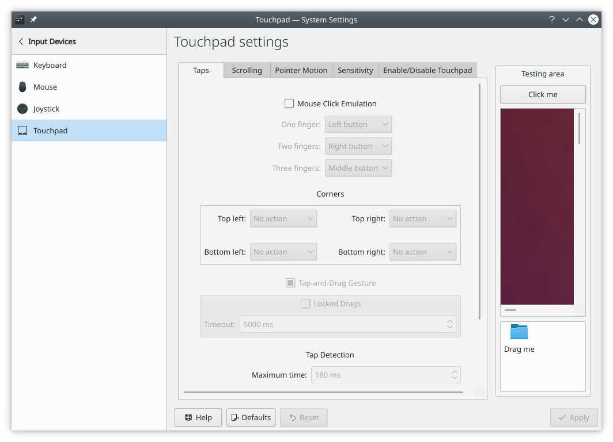
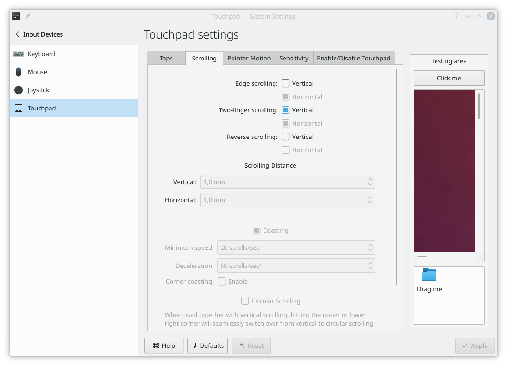
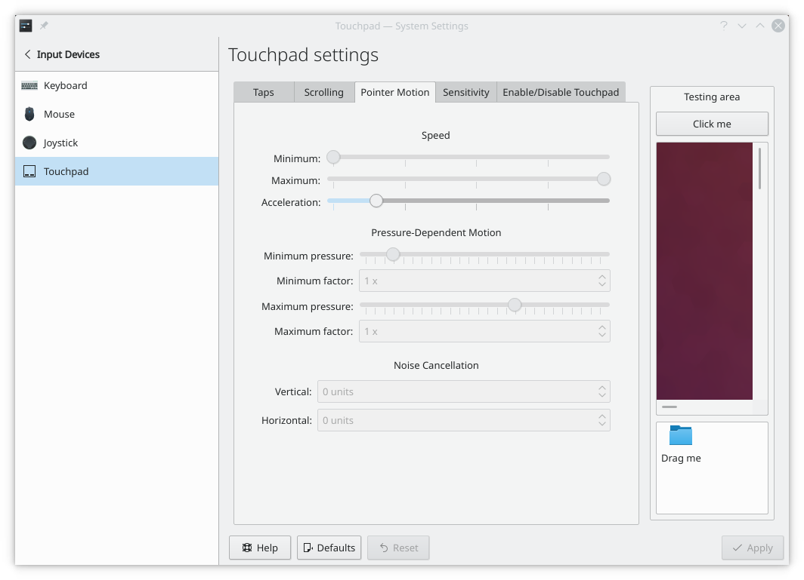
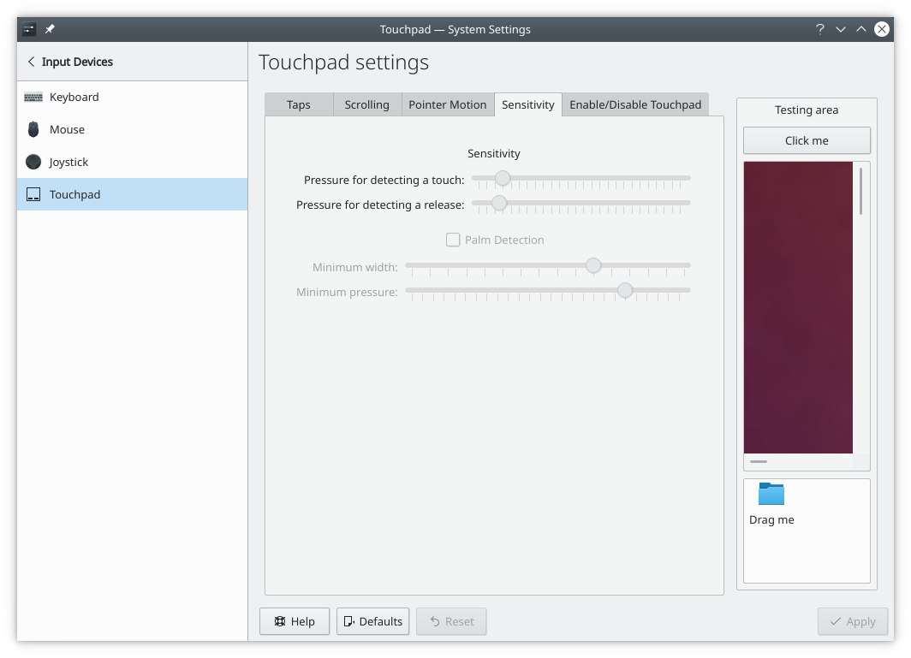
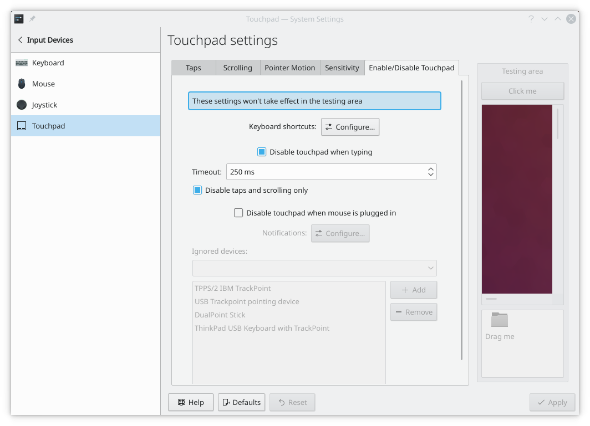

# Touchpad

This module manages the settings of your touchpad. The settings vary with your hardware and the drivers installed. These screenshots show an older layout, and the current settings are arranged differently.

