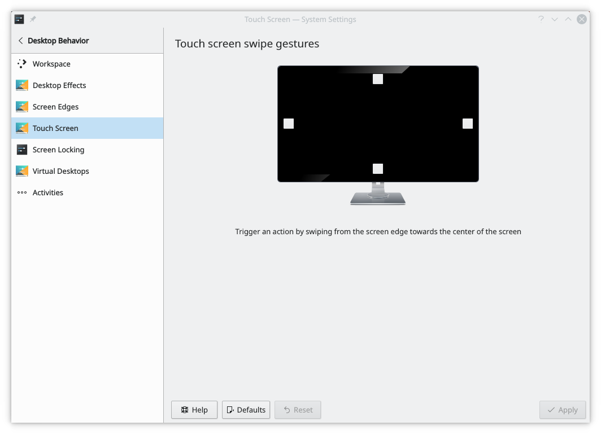

# Touchscreen Gestures

Swiping from the screen edge towards the center of the screen lets you trigger actions. Here you set which action happens on each edge.

Click a square with any mouse button and select an action from the menu. A highlighted square has an action attached, and a gray one has none.

How many actions are available depends on the effects turned on in [Desktop Effects](desktop-effects.md).
