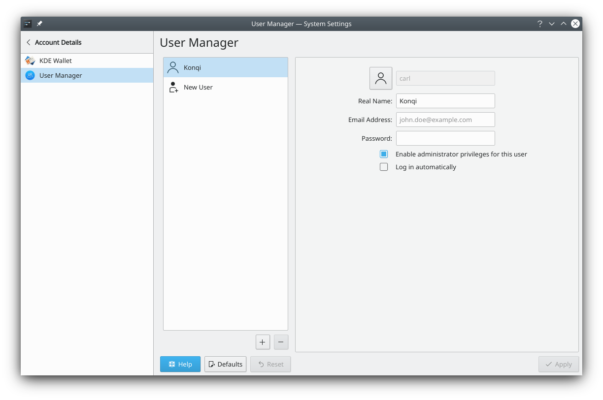

# Users

Here you can change your password and the picture for your account, edit your name, and manage the accounts on your computer, if you have permission.

The module lists the accounts on your computer. Click one to see and change its details.

## Adding a user

**Add New…** at the top of the list opens **Create User**. Enter the **Name:**, the **Username:** and the **Account type:**, **Standard** or **Administrator**, then type the **Password:** twice, in **Password:** and **Confirm password:**. The passwords must match before **Create** adds the account.

## Changing a user's details

The details page of an account has these fields:

- **Name:** The person's full name.
- **Username:** The name used to log in. It can't be changed while that user is logged in, and you can't change your own while you're logged in.
- **Account type:** **Standard** or **Administrator**. An administrator can only be made a standard user while there's at least one other administrator account.
- **Email address:** The person's email address.

**Change Password** opens a dialog where you type the new password into **Password** and **Confirm password**, then click **Set Password**. When you change your own password and you have a default wallet, the module asks **Change Wallet Password?**, because the wallet that stores your passwords for wireless networks and other encrypted resources is locked with its own password. **Change Wallet Password** sets it to match, and **Leave Unchanged** keeps it as it is.

## Changing the picture

To change the picture, click **Change avatar**. **Change Avatar** shows the available pictures, and three more choices:

- **Choose File…** loads an image file from your computer. **Select Picture Area** then lets you choose the part of the image to use.
- **Initials** uses the person's initials on a colored background.
- **Placeholder Icon** uses a generic person icon on a colored background.

Once you've chosen, click **Apply**.

## Fingerprints

If a fingerprint reader is found, the details page shows **Configure Fingerprint Authentication…**. It opens **Configure Fingerprints**, where **Add** enrolls a new finger: pick the finger, then press it on the sensor repeatedly until it's enrolled. Each enrolled finger can be enrolled again with **Re-enroll finger** or removed with **Delete fingerprint**. Click **Done** when you've finished. Fingerprints can be used in place of a password when unlocking the screen and when giving applications and command-line programs administrator permissions. Logging in with a fingerprint isn't supported yet.

## Deleting a user

**Delete User…** offers **Delete files**, which also removes the person's home folder, or **Keep files**, which only removes the account. You can't delete your own account while you're logged in. If the user is logged in, the module asks you to confirm first, because they won't be able to log in again and may see odd behavior until they log out; their files can't be deleted while they're logged in.

## More information

- [Users and groups on the Arch Linux wiki](https://wiki.archlinux.org/title/Users_and_groups)
