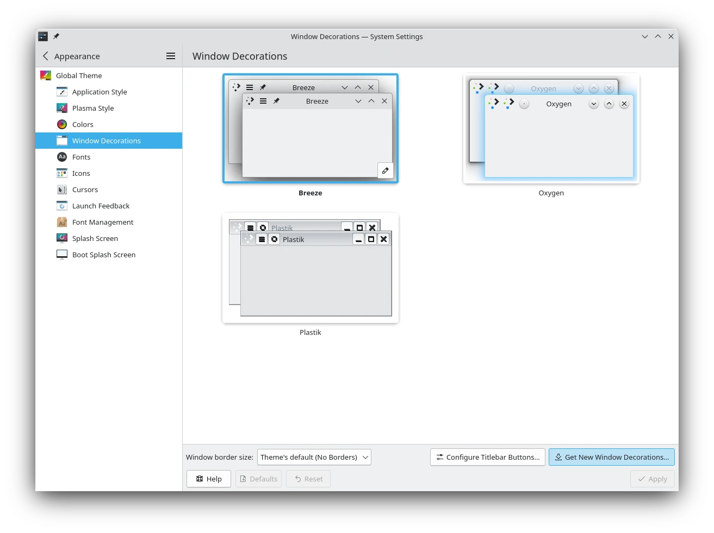
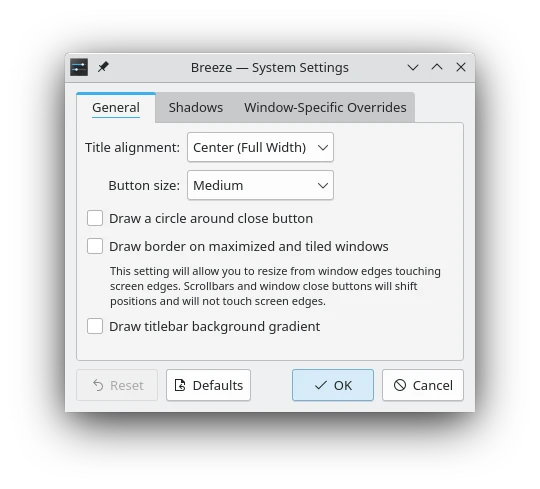
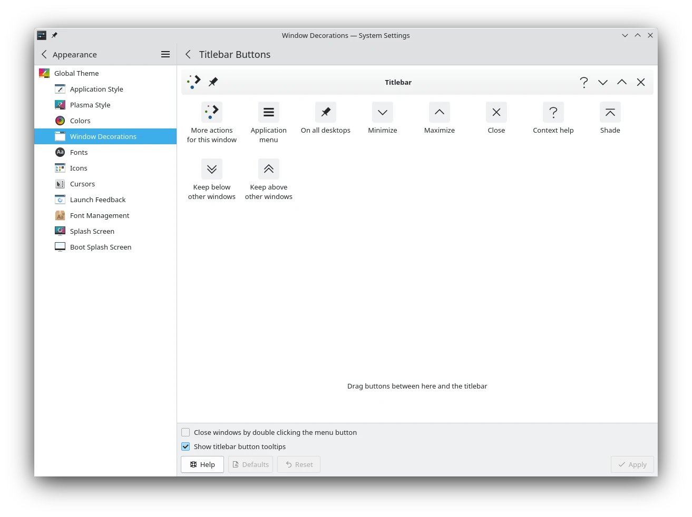

# Window Decorations

This module lets you select a style for the buttons and borders around windows.

## Choosing a style

Choose a style from the preview list, or download a new one with **Get New…**.

Each style has a different look, but also a different feel. Some have sometimes invisible resize borders all around the edge, which make resizing easier but moving harder. Some have no borders on certain edges. Experiment with the styles to find one that suits how you work.

The preview of each style has an edit button, **Edit Theme…**, to open its settings. These apply to all windows. For different options on particular windows, see [Window Rules](window-rules.md).

> [!TIP]
> For accessibility, some styles support extra wide borders. If yours does, **Window border size** lets you choose one here. Large borders are easier to see for low-vision users, and easier to grab for people with limited mobility or difficulty using a mouse.

> [!TIP]
> To create your own window decoration, see [Aurorae window decorations](../../developer/plasma/aurorae/index.md).

## Configuring the titlebar

**Configure Titlebar…** has these settings, which apply to every style.

### Titlebar opacity

- **Active window** and **Inactive window:** How transparent the titlebar is, from **Transparent** to **Opaque**.
- **Always make maximized titlebars opaque.**
- **Blur titlebars that have transparency.**
- **Apply these opacity settings to the entire header area:** Also includes toolbars and menu bars.
- **Match the titlebar to the application color.**

### Exceptions

**Add Exception** changes only the titlebar opacity settings above, for the applications it matches. Enter an application name or window class as a regular expression, and **Override** whichever settings you want. **Remove Exception** deletes it.

### Titlebar buttons

This part sets where the buttons are on the titlebar. Drag buttons between the list and the titlebar, or around the titlebar until you have the order you want. To remove one, drop it back in the list.

- **Close windows by double clicking the menu button:** An extra way of closing, useful if you've removed the Close button.
- **Show titlebar button tooltips:** Shows tooltips when you hover over the buttons.
