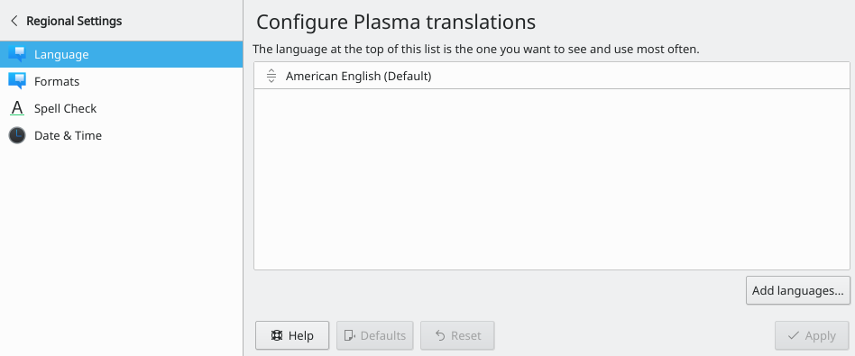
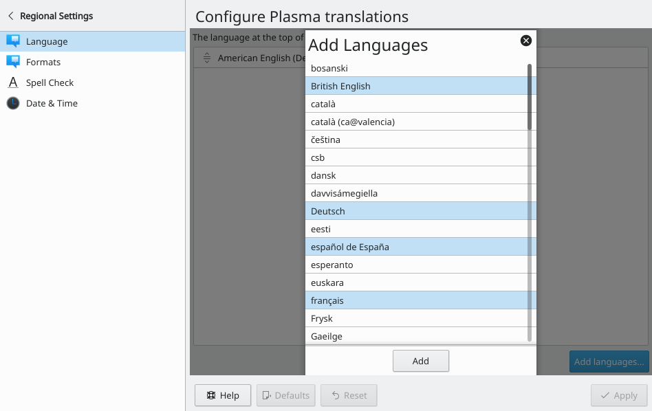
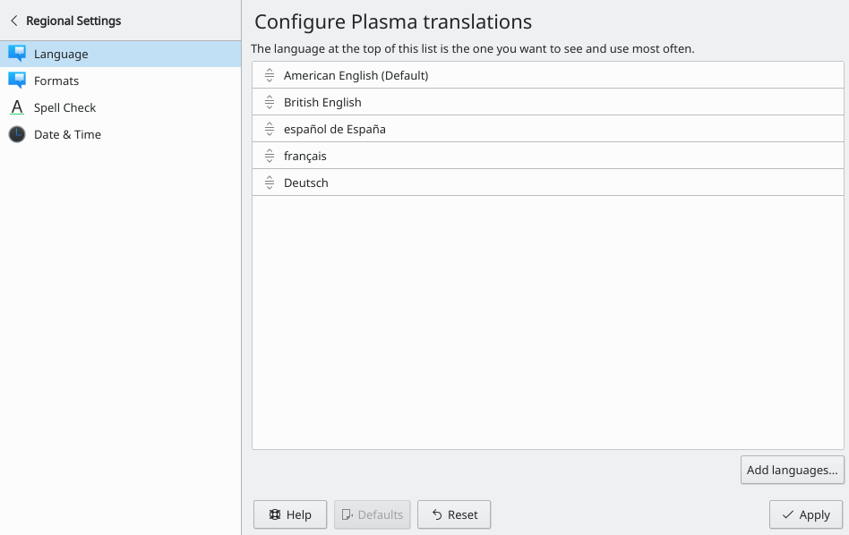
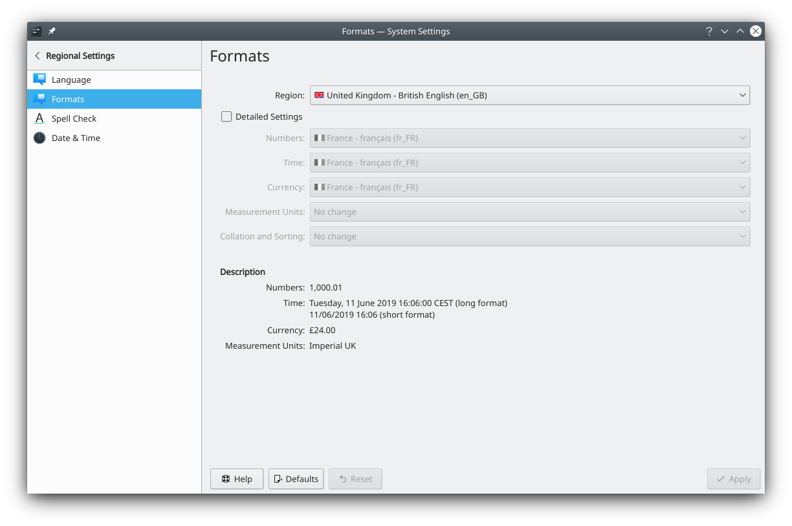

# Changing the desktop language

SonicDE and many other applications are offered in multiple languages. If you aren't familiar with English, or you prefer your native language, you can change your system's language.

These older screenshots show the separate modules from before they were merged into [Region & Language](../settings/region-language.md).

## Language

To change the language, open the [Region & Language](../settings/region-language.md) module and go to the **Language** entry.

To add a language, click **Modify…**, then **Add More…**. A dialog lists the languages you can add, and you can add several at once.

Confirm your selection by clicking **Add**.

Choose the language you want to use by dragging it to the top of the list.

You'll see the change the next time you log in.

## Formats

Once you've set the language, you still need to change the formats for currency, numbers, the time and so on. This is in the same module.

You can use the formats of a region, or set **Numbers**, **Time**, **Currency** and others individually.

Don't forget to click **Apply** to save your configuration.
