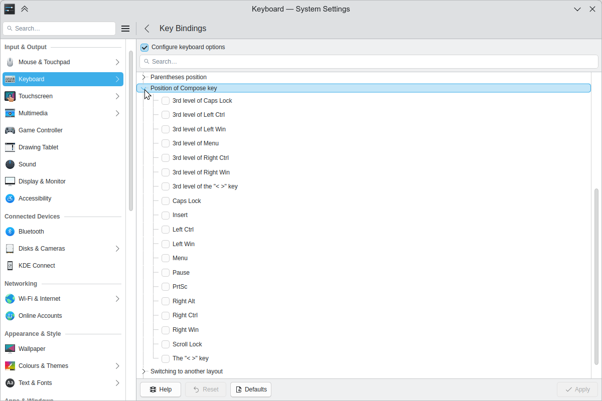

# Using the Compose key

The *Compose key* lets you type characters that usually aren't on your keyboard's keys, such as an [umlaut](https://en.wikipedia.org/wiki/Umlaut_(diacritic)), a [macron](https://en.wikipedia.org/wiki/Macron_(diacritic)) or accents on letters.

This works with almost all applications, including the desktop, browsers and LibreOffice, as well as many console applications.

These instructions set up a Compose key on the right logo key, which on most keyboards shows the Windows logo.

## Setting it up



1. Open the [Keyboard](../settings/keyboard.md) module in System Settings.
2. Go to **Key Bindings**.
3. Tick **Configure keyboard options**.
4. Expand **Position of Compose key**.
5. Tick the key you want to use.

## Console configuration

On Debian-based systems, you can reconfigure the console for your keyboard and character encoding, in a text terminal:

```sh
sudo dpkg-reconfigure console-setup
```

Follow the steps:

- Choose your keyboard.
- If you want an AltGr replacement, choose one.
- Choose the key for your Compose key.
- Set the console's encoding to UTF-8.
- Choose the character sets that should be available on the console.
- Choose the type of console output you'd like. The current defaults are safe.

A new initial RAM disk is then created for the next boot.

## GTK applications

If Compose doesn't work out of the box in GTK applications, they may be using a different input method. To make one application use the X input method, set the `GTK_IM_MODULE` environment variable when you start it:

```sh
GTK_IM_MODULE=xim firefox
```

To set it for a whole shell session:

```sh
export GTK_IM_MODULE=xim
```

To keep this for your whole desktop session, see [Session environment variables](../administration/session-environment-variables.md).

If you have `run_im ibus` in `.xinputrc`, delete that line, then restart.

## Adding your own sequences

You can add more characters, or put characters in more convenient places. Create a `~/.XCompose` file with lines like these:

```text
# ~/.XCompose
# This file defines custom Compose sequences for Unicode characters

# Import default rules from the system Compose file:
include "/usr/share/X11/locale/en_US.UTF-8/Compose"

# To put some stuff onto compose key strokes:
<Multi_key> <minus> <greater> : "→" U2192 # Compose - >
<Multi_key> <colon> <parenright> : "☺" U263A   # Compose : )
<Multi_key> <h> <n> <k> : "hugs and kisses" # Compose h n k
```

Log out and in again, and you can use your new sequences. As you can see, this even works for longer strings of text.

## Typing macrons, umlauts and accents

The Compose key is now whatever you've set it to be, such as the right logo key.

- **Macrons:** Press Compose, then Shift+hyphen (underscore), then a vowel: āēīōū ĀĒĪŌŪ
- **Umlauts:** Press Compose, then Shift+single quote (double quotes), then a vowel: äëïöü ÄËÏÖÜ
- **The German *Eszett*:** Press Compose, then `s` twice: ß

You'll find more sequences in `/usr/share/X11/locale/en_US.UTF-8/Compose`.
