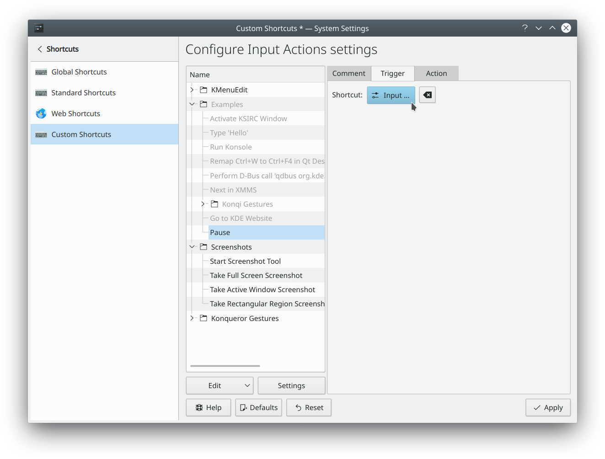

# Custom shortcuts

You can set any key or combination of keys to trigger an action on your computer. For example, you might want the Pause key to lock your screen when you pause your work. Here's how.

1. Open the [Shortcuts](../settings/shortcuts.md) module in System Settings.
2. Click **Add New** and choose **Command or Script…**.
3. Enter this command:

   ```sh
   qdbus6 org.kde.screensaver /ScreenSaver org.freedesktop.ScreenSaver.Lock
   ```

4. Select the new entry and click **Add New** next to its shortcuts.
5. Press the Pause key.
6. Click **Apply**.
7. Test it by pressing the Pause key.

This older screenshot shows the same idea in the Custom Shortcuts module, which no longer exists.


