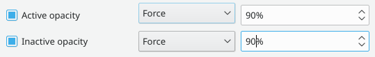

# Forcing transparency and blur

## Window decorations only

To get translucent titlebars, you need window decorations that are translucent, and the blur effect turned on in the [Desktop Effects](../settings/desktop-effects.md) module. The [Window Decorations](../settings/window-decorations.md) module has a **Titlebar opacity** setting.

## Window body transparency

### Keeping your current style

You don't need anything extra to make windows translucent.

Create a [window rule](../settings/window-rules.md): press Alt+F3, then choose **More Actions > Configure Special Window Settings…**. Set **Window class** to **Unimportant**. Also select all window types apart from Desktop and Splash Screen, so that the rule applies to everything. Add the **Active opacity** and **Inactive opacity** properties and **Force** them to the amount you want.



Create another rule above the first as an exclusion. Separate the window classes with `|`, for example `conky|pqiv|sonicshell`, set **Window class** to **Regular expression**, and force the opacity to 100%. If you don't know a window's class, use **Detect Window Properties**. See [Detect Window Properties](../settings/window-rules.md#detect-window-properties).

### Kvantum

Kvantum isn't part of SonicDE, but you can install it from [its GitHub page](https://github.com/tsujan/Kvantum/tree/master/Kvantum). Choose the Kvantum style in the [Application Style](../settings/application-style.md) module, then choose a Kvantum theme in its separate application, Kvantum Manager. To get blur, install a Kvantum theme with transparency, and choose it as your current theme.

## Blur

The blur effect blurs behind windows that ask for it. A script that runs at startup can ask for it on behalf of an application's windows, by setting the `_KDE_NET_WM_BLUR_BEHIND_REGION` property. This needs the `xdotool` and `xprop` tools:

```sh
if [[ $(ps --no-header -p $PPID -o comm) =~ '^yakuake|sonic-ecco$' ]]; then
    for wid in $(xdotool search --pid $PPID); do
       xprop -f _KDE_NET_WM_BLUR_BEHIND_REGION 32c -set _KDE_NET_WM_BLUR_BEHIND_REGION 0 -id $wid;
    done
fi
```

SonicWin scripts from the [KDE Store](https://store.kde.org/p/1294604/) can do the same thing. Manage them in the SonicWin Scripts module.

Menus are the exception: **Blur menus** in the blur effect's settings decides for every see-through menu, whether the menu asks for blur itself (as Silver's do) or is made see-through by the Translucency effect. Turned off, no menu is blurred.
